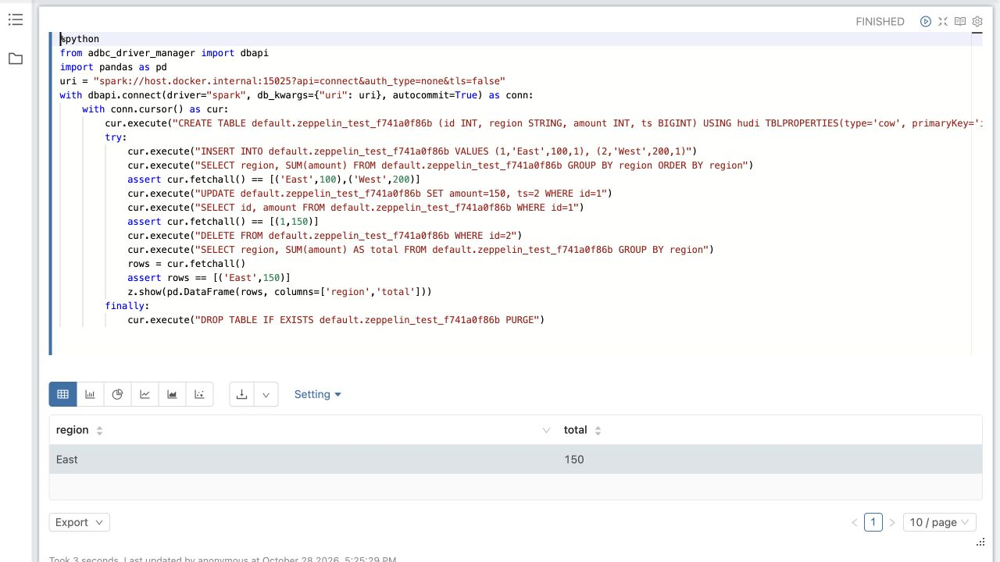

<!--
Licensed to the Apache Software Foundation (ASF) under one
or more contributor license agreements.  See the NOTICE file
distributed with this work for additional information
regarding copyright ownership.  The ASF licenses this file
to you under the Apache License, Version 2.0 (the
"License"); you may not use this file except in compliance
with the License.  You may obtain a copy of the License at

   http://www.apache.org/licenses/LICENSE-2.0

Unless required by applicable law or agreed to in writing, software
distributed under the License is distributed on an "AS IS" BASIS,
WITHOUT WARRANTIES OR CONDITIONS OF ANY KIND, either express or implied.
See the License for the specific language governing permissions and
limitations under the License.
-->

# Hudi Spark Connect endpoint

Deploys Spark Connect 4.1.3 with Hudi 1.2.0, Scala 2.13, and Java 17.
Tables use an external Hive Metastore and S3-compatible storage.
See the [Dockerfile](../../images/spark-connect/Dockerfile) for dependency versions.
The delivery scope is interactive SQL reads and writes, not general Spark job
submission or a required DataFrame-write integration.

## Local-dev quickstart

Requires Docker, minikube, Helm, and kubectl. Run from the repository root:

```bash
# Start MinIO, Hive Metastore, and Spark Connect
./hudi-lakehouse/scripts/quickstart.sh --spark-connect

# Also write example data and query it through Spark Connect (requires Maven and a JDK)
./hudi-lakehouse/scripts/quickstart.sh --run-example --spark-connect
```

The example uses the existing Spark writer to populate and register `default.trips`,
then prints city counts: `chennai = 33`, `san_francisco = 34`, `sao_paulo = 33`.
The query runs through PySpark inside the endpoint pod; no host client is needed.
Omit `--spark-connect` to query through Trino instead.

To rebuild the image and reload the running endpoint:

```bash
./hudi-lakehouse/scripts/quickstart.sh --spark-connect --rebuild-images
kubectl -n hudi-lakehouse rollout restart deployment/hudi-spark-connect
kubectl -n hudi-lakehouse rollout status deployment/hudi-spark-connect
```

## Install against existing infrastructure

Build an image and supply your metastore, warehouse, and storage credentials:

```bash
./hudi-lakehouse/scripts/build-connect-image.sh --registry my.registry/team --push
helm upgrade --install hudi-spark-connect hudi-lakehouse/charts/hudi-spark-connect \
  --namespace hudi-lakehouse --create-namespace \
  --set image.repository=my.registry/team/hudi-lakehouse-spark-connect \
  --set catalog.metastoreUri=thrift://my-hms:9083 \
  --set catalog.warehouse=s3a://my-bucket/connect \
  --set storage.s3.existingSecret=my-s3-credentials \
  --wait --timeout 10m
```

The Secret must be in the same namespace and contain `accessKey` and `secretKey`.
For temporary credentials, also set `storage.s3.sessionTokenKey`.
Without a Secret, Hadoop uses its default credential provider chain.
Local-dev credentials are for development only.

Other settings in [values.yaml](values.yaml):

| Setting | Purpose |
|---|---|
| `storage.s3.endpoint`, `region`, `pathStyleAccess` | MinIO or custom S3 endpoints |
| `spark.cores` | Local worker threads |
| `spark.master` | Empty means `local[cores]`; opt in to a remote master explicitly |
| `spark.driverMemory` | JVM heap; keep the pod memory limit higher |
| `resources` | Driver pod CPU, memory, and optional ephemeral-storage requests/limits |
| `scratch.sizeLimit` | Optional disk-backed `/tmp` volume limit, e.g. `20Gi`; empty by default |
| `spark.extraConf` | Additional Spark properties; no credentials or overrides of chart-owned settings |
| `hudi.defaults` | Server-side `hoodie.*` defaults loaded from `HUDI_CONF_DIR/hudi-defaults.conf` |
| `serviceAccount.name`, `automountToken` | Existing driver account and token mounting; required for Kubernetes executors |

By default the endpoint runs one shared driver in local mode, without separate executors.
Keep one replica. Restarting it ends active sessions; tables remain in the
external metastore and object store.

Size `/tmp` for peak concurrent shuffle/spill and temporary write data, with headroom.
For example, `--set scratch.sizeLimit=20Gi` caps the driver's scratch volume; it does
not reserve disk. Set `resources.requests.ephemeral-storage` for scheduling and
`resources.limits.ephemeral-storage` for the pod budget, allowing for logs and the
writable container layer as well. Node disk pressure can evict the pod before the
volume reaches its limit. Scratch data is lost with the pod; this is not table storage.
In cluster mode, size executor scratch separately; this setting applies only to the driver.

The service has no authentication or TLS. Keep it on a trusted network:
any client that can connect can read and write using the server's storage credentials.
In Kubernetes executor mode, this trust also extends to the driver's ServiceAccount
permissions, including creating executor pods through the Kubernetes API.

## Hudi writer defaults and table services

The generic chart does not pin a table version. The local-dev values set:

```yaml
hudi:
  defaults:
    hoodie.write.table.version: "8"
    hoodie.write.auto.upgrade: "false"
```

This keeps new tables compatible with the local-dev Trino reader. Hudi 1.2.0
otherwise defaults to table version 9. These are defaults, not enforcement:
explicit session/table settings can override them. Changing them does not downgrade
existing tables. Verify the versions supported by every reader before changing the pin.
The smoke test deliberately does not repeat the pin in `CREATE TABLE`.

Use `hudi.defaults` for deployment-wide defaults, `TBLPROPERTIES` for table-specific
settings, and session `SET` for a writer operation. For example:

```sql
CREATE TABLE orders (id INT, amount INT, ts BIGINT) USING hudi
TBLPROPERTIES (type = 'cow', primaryKey = 'id', preCombineField = 'ts',
               'hoodie.clustering.inline' = 'false');

SET hoodie.clean.automatic = true;
INSERT INTO orders VALUES (1, 100, 1);
RESET hoodie.clean.automatic;
```

Trino needs partition metadata in HMS as well as the Spark catalog entry. Ensure
the writer syncs partitions to HMS. To configure sync explicitly, add these
`TBLPROPERTIES` when creating a table (use your metastore URI):

```sql
'hoodie.datasource.meta.sync.enable' = 'true',
'hoodie.datasource.hive_sync.enable' = 'true',
'hoodie.datasource.hive_sync.mode' = 'hms',
'hoodie.datasource.hive_sync.metastore.uris' = 'thrift://hive-metastore.hudi-lakehouse.svc.cluster.local:9083'
```

The SQL matrix includes partition sync and Trino readback. These properties are not
enabled by the generic chart or local-dev defaults.

Table properties and session settings take precedence over global defaults in
the Spark SQL write configuration; consult the relevant Hudi operation's settings
when overriding them. Quote Helm property values when exact numeric text matters.
Do not store credentials in `spark.extraConf` or `hudi.defaults`: both are ConfigMaps.
Configuration changes roll the driver and end existing sessions.
Hudi's defaults-file parser keeps backslashes literally but normalizes whitespace;
the chart rejects leading/trailing or repeated whitespace rather than silently
changing such values. This differs from Spark's Java-properties escaping.

The endpoint does not schedule separate table-service jobs. Services enabled on a
SQL writer run according to Hudi's configuration in the shared Spark application.
In Hudi 1.2.0 inline compaction and inline clustering default to **off**; automatic
cleaning is enabled by default. Enabling inline compaction/clustering adds work to
the write path and can affect interactive-query latency. For example, a MoR writer
can set `hoodie.compact.inline=true` and `hoodie.compact.inline.max.delta.commits=2`.
For externally managed compaction/clustering, the operator must arrange both
scheduling and execution; this chart creates neither a scheduler nor a worker job.

The caller/operator owns writer configuration, concurrency mode and lock provider
across **all** writers, including external Spark/Flink jobs. Separate Connect sessions
do not provide multi-writer coordination. This endpoint adds no locking policy,
workload isolation, or custom recovery guarantees. Embedded timeline-server reuse
(`hoodie.embed.timeline.server.reuse.enabled`) is not enabled here and needs separate
evaluation before changing its lifecycle in a long-running driver.

## Kubernetes executor configuration (opt-in)

The chart exposes the configuration needed for a shared driver with separate
executors. Local mode remains the default. In a single-node local kind test on
ARM64, a driver with two 1 GiB executor pods registered both executors and ran
Hudi INSERT/UPDATE/DELETE/MERGE, readback and driver restart/persistence checks
against local MinIO and HMS. The test image used the pinned Spark/Hudi image with
the current repository's executor entrypoint overlaid; the complete Dockerfile
also built successfully. This is a functional test, not a scale or isolation claim.

```yaml
spark:
  master: k8s://https://kubernetes.default.svc:443
  extraConf:
    spark.executor.instances: "2"
    spark.executor.cores: "1"
    spark.executor.memory: 1g
serviceAccount:
  name: spark-connect-driver
  automountToken: true
```

Provision this ServiceAccount and its executor-management RBAC in the release
namespace first. The local test allowed get/list/watch/create/delete/patch on pods,
services and ConfigMaps, plus get/list/watch on persistent volume claims; tune and
review permissions for your deployment. The chart does not grant permissions. In Kubernetes client mode,
it advertises the driver's Pod IP and Pod name, selects the release namespace,
and defaults the executor image to the same Hudi-enabled image. The image delegates
executor startup to Spark's base entrypoint. Rebuild it when updating the entrypoint;
an older image will not provide that behavior. Executors receive the configured S3
Secret references, including a session token when present, without embedding values
in Spark properties. The Hudi defaults file is loaded by the SQL driver; the resolved
write configuration is passed by Hudi to tasks.
Set `spark.kubernetes.authenticate.executor.serviceAccountName` to a dedicated,
minimal-permission executor ServiceAccount; otherwise executors use the namespace's
default account. Disable token automount on that account unless the workload needs it.

Before using this mode, validate driver/executor networking, resource capacity,
image availability/pull credentials, and storage access from executor pods. Use
`spark.kubernetes.executor.container.image` for a different compatible executor image,
and Spark's executor settings for placement, workload identity, or
credentials other than the chart's S3 Secret. Driver pod settings do not automatically
apply to executors. Keep executors in the release namespace when using its Secrets.
The chart defaults executor pull secrets from `imagePullSecrets`; override
`spark.kubernetes.container.image.pullSecrets` for a different comma-separated list.
Dynamic allocation/autoscaling is not enabled by this example. In a separate local
kind test with shuffle tracking enabled, min/initial executors 1, max 2, 1-second
backlog thresholds and a 30-second idle timeout, a 64-partition SQL workload
scaled from one executor to two and returned to one after becoming idle. Hudi
CRUD/MERGE and driver restart/readback also passed in this mode. This validates
only that local configuration and workload, not autoscaling under production load. Keep one driver replica; this is not a tenant-isolated service.
Standalone (`spark://`) masters are not supported by this chart.

## Connect and validate with ADBC

Forward the endpoint for local clients:

```bash
kubectl -n hudi-lakehouse port-forward svc/hudi-spark-connect 15002:15002
```

| Client | URI |
|---|---|
| PySpark | `sc://localhost:15002` |
| Foundry ADBC | `spark://localhost:15002?api=connect&auth_type=none&tls=false` |

ADBC requires `api=connect`; its default is Thrift. In-cluster clients can use
`hudi-spark-connect.hudi-lakehouse.svc:15002` without port-forwarding.
The ADBC driver is installed on the client, not the server.

For the CRUD and restart test, prepare a Python 3.11 environment:

```bash
python3.11 -m venv .venv-connect
. .venv-connect/bin/activate
pip install -r hudi-lakehouse/local-dev/example/connect-requirements.txt dbc==0.3.1
dbc install 'spark=0.2.1'
```

Stop any manual port-forward before running the test; it manages its own:

```bash
PYTHON="$VIRTUAL_ENV/bin/python" \
  ./hudi-lakehouse/local-dev/scripts/test-spark-connect.sh --restart-endpoint
```

The test creates a temporary table, checks INSERT/UPDATE/DELETE/MERGE, restarts the
endpoint, verifies persistence, and cleans up. It interrupts active sessions.
On failure, follow the printed cleanup instructions.

Additional checks against a local-dev deployment:

```bash
PYTHON="$VIRTUAL_ENV/bin/python" \
  ./hudi-lakehouse/local-dev/scripts/test-spark-connect.sh \
  --restart-endpoint --sql-matrix --freshness --trino
```

- `--sql-matrix`: CoW time travel and incremental TVF, partitioned CoW with HMS
  sync, MoR snapshot/read-optimized reads and a completed inline compaction. Checks
  stored table version 8 without statement-level version overrides; set
  `EXPECTED_TABLE_VERSION=9` when deliberately testing a v9 deployment.
- `--trino`: implies `--sql-matrix`; compares CoW and partitioned-table rows through
  an **already running** `hudi-trino` deployment (override `TRINO_DEPLOYMENT` if needed).
  Connect-only quickstart does not install Trino. An unavailable/incompatible Trino
  fails the check rather than skipping it. This tests Connect-created tables, not
  just external-writer tables queried by both engines.
- `--freshness`: keeps one ADBC connection open while a separate Spark JVM commits
  data, adds a column, and then recreates its test table. The supplied fixture creates
  short-lived writer pods using the Connect image by default and shared catalog/storage;
  it is **not** another Connect session. Set `EXTERNAL_WRITER_IMAGE` to use a
  separately built writer image, such as the Spark 3.5 fixture below.
  Allow an additional 1 GiB memory request (1.5 GiB limit), CPU, and permissions to
  create/delete pods and ConfigMaps. Only uniquely named test resources are touched.

Freshness checks do not automatically refresh or reconnect. If they fail on stale
metadata, rerun with `--freshness --refresh` to test explicit `REFRESH TABLE` after
each external change. Record which mode passes for your version combination;
do not claim automatic visibility based on a refresh-assisted run. The fixture
does not alter shared example tables, and cleanup never uses `DROP DATABASE CASCADE`.
Other external writers can use the Python CLI's `--external-writer <command argv>`
hook; it receives the test database and `commit-schema` / `recreate` action.

For the Spark 3.5 writer fixture, build the image and make it available to the
cluster (for kind, load it into the cluster), then run the same check:

```bash
docker build -t hudi-spark35-writer:local hudi-lakehouse/images/spark-3.5-writer
kind load docker-image hudi-spark35-writer:local --name <cluster-name>
EXTERNAL_WRITER_IMAGE=hudi-spark35-writer:local \
  ./hudi-lakehouse/local-dev/scripts/test-spark-connect.sh \
  --restart-endpoint --freshness --refresh
```

The fixture uses Spark 3.5.7 and Hudi 1.2.0 in a separate JVM with the endpoint's
catalog and storage configuration. With a Spark 4.1.3 / Hudi 1.2.0 Connect
server, explicit refresh passed after external commits, schema evolution, and
recreation; the original table remained readable after an endpoint restart. Without
refresh, the existing session could not resolve the externally added column. This
single combination does not establish general cross-version compatibility.

A separate local-file experiment used Flink 1.20.1 / Hudi 1.2.0 to write a
CoW table, and Spark 4.1.3 / Hudi 1.2.0 Connect to register and read that path.
With the same Connect session open, a second Flink upsert was stale until
`REFRESH TABLE`, after which the updated and inserted rows were visible. Both
processes shared a disposable Docker volume; this did not exercise Hive
Metastore sync, object storage, schema evolution, or concurrent writers. To
reproduce the write side with the Hudi Flink bundle loaded in Flink SQL, use a
shared path that both runtimes can access:

```sql
SET 'execution.runtime-mode' = 'batch';
SET 'table.dml-sync' = 'true';
SET 'parallelism.default' = '1';
CREATE TABLE orders (id STRING PRIMARY KEY NOT ENFORCED, amount INT, ts BIGINT)
WITH ('connector' = 'hudi', 'path' = 'file:///data/flink_orders',
      'table.type' = 'COPY_ON_WRITE', 'write.precombine.field' = 'ts',
      'write.tasks' = '1');
INSERT INTO orders VALUES ('1', 100, CAST(1 AS BIGINT)), ('2', 200, CAST(1 AS BIGINT));
-- In a later SQL client session, recreate the same table definition, then:
INSERT INTO orders VALUES ('1', 150, CAST(2 AS BIGINT)), ('3', 300, CAST(2 AS BIGINT));
```

Register the written path with `CREATE TABLE flink_connect_orders USING hudi
LOCATION 'file:///data/flink_orders'` in Connect. On the tested combination,
`SELECT id, amount, ts ... ORDER BY id` returned the original two rows before
refresh and `(1, 150, 2), (2, 200, 1), (3, 300, 2)` after
`REFRESH TABLE flink_connect_orders` (the IDs are strings).

These acceptance paths require live Spark/ADBC (and optionally Trino). Offline
tests validate their assertions, configuration and cleanup, not engine behavior.
With Spark 4.1.3, Hudi 1.2.0 and Foundry 0.2.1, the live SQL matrix, Trino 472
readback of CoW and partitioned tables, and endpoint restart checks passed.
An existing session did not see an externally added column until
`REFRESH TABLE`; with explicit refresh, external writes, schema changes and table
recreation passed. Further end-to-end validation is tracked in
[#20233](https://github.com/apache/hudi/issues/20233).

## Agent gateway

See the [gateway setup and limits](../../../hudi-agent-gateway/README.md#spark-connect-backend).
The Agent and MCP interfaces share the same three read-only tools:
`list_tables`, `describe_table`, and `query_lakehouse`.

Build the gateway image, which includes the official PySpark Connect client:

```bash
docker build -t hudi-lakehouse-agent-gateway:0.1.0 hudi-agent-gateway
```

Load or push that image for your cluster, then install the gateway from the
repository root:

```bash
helm upgrade --install hudi-agent-gateway hudi-lakehouse/charts/hudi-agent-gateway \
  -n hudi-lakehouse \
  -f hudi-lakehouse/charts/hudi-agent-gateway/values-local-dev.yaml \
  -f hudi-lakehouse/charts/hudi-agent-gateway/values-spark-connect.yaml
```

This retains the local-dev Ollama configuration. `/ready` checks Spark with
`SELECT 1` and checks the configured LLM separately. MCP tool calls themselves
do not require an LLM. Override the provider as described in the gateway README.

In a single kind environment with the Helm Connect and gateway charts, a local
Ollama `qwen3:4b-instruct` model completed the HTTP Agent describe and follow-up
aggregation checks; HTTP MCP returned query results and rejected a DELETE. The
Superset SQL Lab/chart API and Zeppelin notebook live tests also passed against
the same Connect deployment. Gateway uses the official PySpark Connect client;
Superset and Zeppelin use Foundry ADBC. These checks use isolated test tables and
do not establish production concurrency or authentication behavior.

<a id="spark-connect-client-tutorials"></a>

## BI clients

The [experimental Superset adapter](../../superset-spark-connect/README.md)
provides a SQLAlchemy dialect and Superset engine spec for Foundry ADBC. Follow
its installation instructions and application-level checks. Those checks are
separate from the endpoint acceptance tests above.

For Zeppelin 0.12, install the ADBC packages and Foundry driver into the Python
environment used by the `%python` interpreter. Its official 0.12.0 image uses
Python 3.9, so the manager 1.12.0 requirements above do not apply to that image.
The following tested versions are installed as that interpreter's user (or at
system level where they are readable by that user):

```bash
python3 -m pip install adbc-driver-manager==1.8.0 pyarrow==18.1.0 dbc==0.3.1
dbc install 'spark=0.2.1'
```

In a notebook, connect to the endpoint and render a query (replace the table with
an isolated test table):

```python
%python
from adbc_driver_manager import dbapi
import pandas as pd
with dbapi.connect(driver="spark", db_kwargs={"uri": "spark://localhost:15002?api=connect&auth_type=none&tls=false"}, autocommit=True) as conn:
    with conn.cursor() as cur:
        cur.execute("SELECT region, SUM(amount) AS total FROM connect_smoke_example.orders GROUP BY region ORDER BY region")
        rows = cur.fetchall()
        z.show(pd.DataFrame(rows, columns=["region", "total"]))
```

The hostname is relative to the Zeppelin interpreter process. Check the rendered
rows against the test fixture, then run INSERT, UPDATE and DELETE and SELECT after
each mutation in a disposable table. This uses `%python`, not native `%jdbc`.
The exact rendered output depends on the installed interpreter. A local run of
Zeppelin 0.12.0's x86_64 image (emulated on ARM), Python 3.9.15, ADBC manager
1.8.0, PyArrow 18.1.0 and Foundry Spark ADBC 0.2.1 executed this path against a
local Spark 4.1.3/Hudi 1.2.0 endpoint. It checked INSERT, UPDATE, DELETE and
readback and rendered the final aggregation:



For a repeatable API-driven check, install `requests` in the test environment,
set `HUDI_ZEPPELIN_URL` and `HUDI_ZEPPELIN_CONNECT_URI` (the latter must be
reachable from the Zeppelin interpreter), and run:

```bash
python -m unittest discover -s hudi-lakehouse/superset-spark-connect -p 'test_zeppelin_live.py' -v
```

Use only a disposable endpoint and notebook server. The Connect URI is stored in
the notebook source, so the test requires `auth_type=none` and rejects credentials
and secret-bearing options. The test creates a unique notebook and table and removes them; if execution is interrupted or the outcome
is ambiguous, wait for the notebook to stop before manually cleaning up the
printed table name. API-created paragraphs must include a table-results config;
without it this Zeppelin version returned a table result via API but its browser
UI failed to render the paragraph.

[Foundry Spark ADBC 0.2.1](https://adbc-drivers.org/drivers/spark/) uses autocommit.

With Spark 4.1.3, Hudi 1.2.0 and Foundry 0.2.1, local fault tests observed that a
write could commit after client disconnect, and retrying `INSERT` after a lost
response produced duplicate rows. Check the data or timeline before retrying.
After a driver restart at the requested-instant stage, the next write rolled back
the unfinished instant and committed. These observations depend on the write
configuration and failure stage; they are not a safe-retry guarantee.
In a local write test, `adbc_cancel()` returned `context canceled` to the client,
but Spark jobs continued and all 200 inserted rows committed, confirmed by a
separate connection and the Hudi timeline. Do not treat a client cancellation
error as proof that a write was stopped or rolled back. The isolated experiment
can be repeated on a disposable, unauthenticated localhost endpoint:

```bash
python hudi-lakehouse/local-dev/example/connect_cancel.py --port 15002 --rows 20000 --delay 1
```

The observer refreshes the table while looking for the complete expected commit;
if it cannot determine the outcome, the script leaves the unique table and
database for inspection after server-side work stops.

To test driver interruption at Hudi timeline stages, start a localhost
port-forward on 15039 to a **disposable, idle** deployment, then run one stage
at a time (15040 must be free for reconnection):

```bash
python hudi-lakehouse/local-dev/example/connect_restart_fault.py --restart-endpoint --stage requested
# Re-establish the 15039 port-forward before the second run.
python hudi-lakehouse/local-dev/example/connect_restart_fault.py --restart-endpoint --stage inflight
```

This forcibly deletes the driver pod and terminates all its sessions. It watches
driver logs for the selected stage, checks the table after restart, verifies a
new write and matching rollback log, then cleans up its unique table. Do not run
other writes on the endpoint during the experiment: the requested-stage log does
not identify the table. If the stage or rollback is not observed, the outcome is
inconclusive and the test data is retained. On a local kind deployment, both
requested and inflight interruptions led to a rollback of the captured instant and
a successful subsequent write. This does not cover every point within those stages
or concurrent writers.

Use `LIMIT` and size client/driver memory for the expected results. Foundry 0.2.1
rejected Arrow responses exceeding its 4 MiB gRPC receive limit in the 100k-row test.
Local-dev sets `spark.connect.grpc.arrow.maxBatchSize=1m`, which allowed that test
to complete. Set the same property in `spark.extraConf` for other deployments using
this driver. It controls batch size, not total result size or memory; oversized
individual rows can still exceed the receive limit.

### SQL, catalog and storage diagnostics

By default, Kubernetes readiness checks only the TCP listener. To opt into
SQL-aware readiness, first provision a persistent non-empty storage-backed probe
table with a non-null ordinary data column and use values like:

```yaml
readiness:
  sql:
    enabled: true
    schema: probe_database
    table: probe_table
    column: probe_column
```

The driver image must include `check-ready.py`; rebuild older images. Startup
continues to use TCP so the driver can initialize before the SQL probe runs.
Readiness checks SQL execution, catalog discovery and an actual table-data query
in sequence. A missing or empty probe table makes the pod unready; provision it
before enabling the option. Checks run every 30 seconds with a 30-second timeout.
In the local kind executor test, the probe passed against a pre-populated Hudi
probe table; changing the configured column to a nonexistent name made the pod
unready. Caching and catalog configuration can affect which backing services a
successful read exercises; this check does not prove write access.

For a separate read-only data-path diagnostic using ADBC, run:

```bash
python hudi-lakehouse/local-dev/example/connect_readiness.py \
  --uri 'spark://localhost:15002?api=connect&auth_type=none&tls=false' \
  --schema probe_database --table probe_table --column probe_column
```

The command reports SQL, catalog and table-data checks separately and exits
nonzero at the first failure. It requires read access and never modifies the probe
table. A missing/empty table is a failure; caching and catalog configuration can
affect which backing services a successful read actually exercises. This external
diagnostic does not itself change Kubernetes readiness or prove write access.

### Spark UI, logs and metrics

For local diagnosis, forward the driver UI to loopback only:

```bash
kubectl -n hudi-lakehouse port-forward --address 127.0.0.1 deployment/hudi-spark-connect 4040:4040
curl http://127.0.0.1:4040/api/v1/applications
curl http://127.0.0.1:4040/metrics/json/
```

These endpoints returned application metadata and metrics in the local kind
executor test. The UI and event logs can expose SQL, configuration and data;
restrict access and do not expose them directly on an untrusted network.

To retain Spark event logs, configure `spark.eventLog.enabled=true` and
`spark.eventLog.dir` in `spark.extraConf` with a pre-created, writable durable
filesystem location. A separately managed Spark History Server can read the same
location through `spark.history.fs.logDirectory`; its storage credentials and
access controls must be configured separately. In a single-node kind experiment,
a test PVC replaced the driver's `/tmp` scratch volume, with
`spark.eventLog.dir=file:/tmp/events`. A separate History Server mounted the same
PVC and used `spark.history.fs.logDirectory=file:/eventlogs/events`. After a
query and driver restart, its API listed the completed application and its
successful jobs. This manual PVC configuration is not provisioned by the chart and
does not validate multi-node volume sharing or production access controls. See
[Spark monitoring documentation](https://spark.apache.org/docs/4.1.3/monitoring.html)
for metrics sinks and history server details.

Spark driver logs include Connect session IDs and Spark job details; Hudi SQL
`CALL show_commits` exposes completed instants. Use timestamps and table names to
investigate a particular write, but this setup does not provide a guaranteed
client-request-to-job-to-commit identifier or complete trace correlation.

### Client-disconnect experiment

On a disposable endpoint, the following creates a unique database and terminates
its own ADBC client during an INSERT. It does not retry the write:

```bash
python hudi-lakehouse/local-dev/example/connect_disconnect.py \
  --uri 'spark://localhost:15002?api=connect&auth_type=none&tls=false' \
  --rows 2000 --delay 1 --wait 90
```

If the complete expected write is observed after refreshing the table, the script
cleans up its own table and database. Otherwise it reports an inconclusive outcome
and leaves them for inspection. Wait until the server-side write has stopped before
manually dropping those resources. On a local Spark 4.1.3 / Hudi 1.2.0 endpoint,
a 20,000-row write was observed after the client was terminated one second after
entering the write. This timing does not guarantee the same outcome in another run.
Earlier inconclusive runs used an invalid INSERT with ambiguous column names and
must not be interpreted as evidence about interrupted writes.

For a controlled lost-response experiment, expose a disposable unauthenticated
endpoint only on localhost and run:

```bash
python hudi-lakehouse/local-dev/example/connect_lost_response.py --port 15002
```

A local TCP proxy forwards client requests while discarding server-to-client bytes
after the connection is established. A separate connection refreshes and checks the
unique table; once all expected rows are visible, the script terminates the client
and cleans up. A local 1,000-row run observed the complete commit while responses
were blocked. With the optional `--retry` flag, the same INSERT is repeated only
after the original commit is observed; in that run it produced 2,000 rows with
1,000 distinct IDs. This shows an ambiguous client outcome can coexist with a committed
write; it does not establish cancellation, automatic retries, idempotency, or behavior
at every failure phase. If the commit is not observed, the script leaves the table
for inspection after the server write stops.

### Result-size experiment

The optional `connect_load.py` reads synthetic `range` rows without creating a
table. Run it only on a disposable endpoint and monitor driver and client memory:

```bash
python hudi-lakehouse/local-dev/example/connect_load.py \
  --uri 'spark://localhost:15002?api=connect&auth_type=none&tls=false' \
  --rows 1000000 --payload-bytes 64 --fetch-size 10000
```

In a local Spark 4.1.3/Hudi 1.2.0 test with a 2 GiB driver heap,
`spark.connect.grpc.arrow.maxBatchSize=1m`, Foundry 0.2.1 and Python 3.11 on
macOS, one million rows each containing an int64 ID and 64-byte ASCII payload
passed count and checksum validation using `fetchmany(10000)`. Client peak RSS
was about 170 MiB; a sampled Spark container value was 2.15 GiB, not a peak.
The standalone container had a 10.2 GiB memory limit; this run does not establish
behaviour under the chart's 3 GiB pod limit. A single 5,000,000-byte string row
failed with Foundry's 4,194,304-byte gRPC receive limit despite the 1 MiB Arrow
batch setting. These are observations, not total-result or memory guarantees.

The opt-in dialect live test also checks Spark `TIMESTAMP_NTZ` with microsecond
precision, decimal(38,18), nullable array elements in a direct SQL result, nested
structs and Hudi commit/key metadata columns. A direct SQL array result does not
establish that Hudi/Parquet can write arrays with NULL elements. In a separate
local CoW table test, an array containing NULL failed during Hudi write; the
server log reported Parquet Avro's old-list-structure null-element restriction.
Setting `spark.hadoop.parquet.avro.write-old-list-structure=false` in the SQL
session did not resolve the failure. Supplying the same property at driver startup
allowed a local CoW INSERT containing `[1, NULL, 3]` to succeed and read back
correctly. In Helm, add the following under `spark.extraConf` before restarting
the endpoint; test the resulting Parquet representation with your readers:

```yaml
spark:
  extraConf:
    spark.hadoop.parquet.avro.write-old-list-structure: "false"
```

The opt-in check below creates and removes a unique database and table. It
requires a disposable endpoint with that startup configuration and a localhost
port-forward:

```bash
python hudi-lakehouse/local-dev/example/connect_nullable_array.py --port 15002
```

The write and readback also passed against the Helm deployment with MinIO and HMS.
This is a Parquet write configuration finding, not a Connect transport failure.
With a UTC Spark session, Mac clients launched with `TZ=UTC` and
`TZ=America/Los_Angeles` both returned the timestamp with UTC zone information
and the timestamp_ntz without a zone, preserving microseconds. Other server and
client timezone combinations remain unverified.

The manually triggered `Hudi Spark Connect live acceptance` GitHub Actions workflow
creates a disposable kind cluster, deploys the chart, runs the SQL matrix and
restart readback, and deletes the cluster. It is distinct from offline chart and
script tests. Its first hosted execution still needs to be verified.

## Troubleshooting

| Symptom | Check |
|---|---|
| Pod stays Pending | Pod events and available cluster memory |
| ImagePullBackOff | Image was built/loaded or pushed; registry is reachable |
| SQL fails despite readiness | Spark logs, metastore connectivity, S3 credentials and bucket; probes check only the TCP listener |
| ADBC driver not found | Install Foundry in the client environment or set `ADBC_DRIVER` to its library path |
| Session fails after restart | Open a new connection |

## Chart checks

Requires Helm, Python with PyYAML, and JDK 11+:

```bash
helm lint hudi-lakehouse/charts/hudi-spark-connect \
  -f hudi-lakehouse/charts/hudi-spark-connect/values-local-dev.yaml
python -m unittest discover -s hudi-lakehouse/tests -v
```

## Teardown

Remove only the endpoint; external table data is retained:

```bash
helm uninstall hudi-spark-connect -n hudi-lakehouse
```

To delete the entire local-dev namespace, including its PVCs and local data:

```bash
./hudi-lakehouse/local-dev/scripts/down.sh
```
