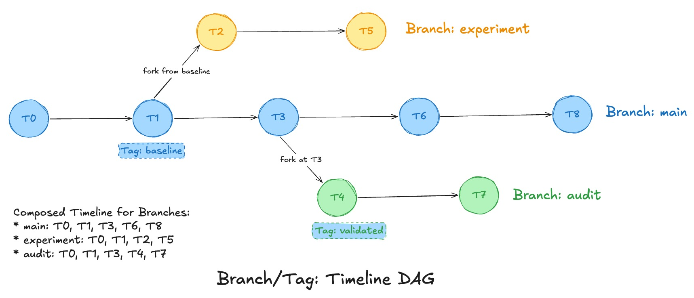

<!--
  Licensed to the Apache Software Foundation (ASF) under one or more
  contributor license agreements.  See the NOTICE file distributed with
  this work for additional information regarding copyright ownership.
  The ASF licenses this file to You under the Apache License, Version 2.0
  (the "License"); you may not use this file except in compliance with
  the License.  You may obtain a copy of the License at

       http://www.apache.org/licenses/LICENSE-2.0

  Unless required by applicable law or agreed to in writing, software
  distributed under the License is distributed on an "AS IS" BASIS,
  WITHOUT WARRANTIES OR CONDITIONS OF ANY KIND, either express or implied.
  See the License for the specific language governing permissions and
  limitations under the License.
-->

# RFC-116: Support Branches and Tags

## Proposers

- @cshuo
- @danny0405

## Approvers

- TBD

## Status

RFC reservation: [#20456](https://github.com/apache/hudi/pull/20456)

## Abstract

Branches and tags are version-control features used to manage parallel development, identify project versions and preserve reproducible points in history. Applied to data tables, these concepts support isolated validation of ingestion and data corrections, and reproducible datasets for audits, reporting and experiments.

This RFC proposes writable branches and read-only tags for Hudi tables. Each branch selects consistent Data and MDT histories, and a tag names a specific completed commit and retains the data and metadata needed to read the table as of that commit. Branch changes can be published to main under explicit compatibility and historical-protection rules. The proposed implementation shares fixed inherited timeline history and stores only incremental commits in each branch’s local timeline. It also shares physical data and index files, uses paired Data and MDT savepoints for tag protection, and extends metadata retention and file cleaning to honor dependencies across branches.

## Background

### Branches and tags

Branches and tags are key features of version control systems. In Git, for example, they are defined as follows:

- **Branch:** A line of development whose head advances as commits are added. Creating a branch starts an independent line from an existing commit while sharing its preceding history. [Git glossary: branch](https://git-scm.com/docs/gitglossary#def_branch).
- **Tag:** A name marking a particular point in history, commonly a release. It does not advance with ordinary commits. [Git glossary: tag](https://git-scm.com/docs/gitglossary#def_tag).

For data tables, a branch maintains an independent commit history, and a tag names a specific completed commit. Reading the table as of that commit reconstructs a snapshot from the branch history, including data retained from earlier commits; it does not read only the changes written by the tagged commit. Repeatable historical reads require protecting the data files and metadata needed to reconstruct that snapshot. Neither concept inherently requires a physical copy of the data.

Typical operations include creating, listing, reading and deleting branches or tags; writing to a branch; and integrating a branch's changes into another branch. Some systems also support renaming, replacing or expiring tags. Deleting a name and reclaiming the files it protected are separate operations when files are shared.

### Ways to integrate branch changes

The following modes describe different semantics for publishing a branch into the main branch.

| Mode and reference | Meaning | Consequence for a data table |
|---|---|---|
| Fast-forward — [Git merge](https://git-scm.com/docs/git-merge) | Advance the target to the source branch's head when the target's current head is an ancestor of the source branch. No additional merge commit is created. | No reconciliation of independently diverged writes; reject when the target has writes absent from the source branch. |
| Three-way merge — [Git merge: True Merge](https://git-scm.com/docs/git-merge) | Compare changes on the source branch and target branch against their common ancestor, producing a combined result. | Requires rules for overlapping updates, deletes, overwrites and table definitions, as well as non-overlapping changes. |
| Rebase or cherry-pick — [Git rebase](https://git-scm.com/docs/git-rebase), [Git cherry-pick](https://git-scm.com/docs/git-cherry-pick) | Replay a sequence of changes, or selected changes, onto another history. | Requires replay semantics and conflict checks; operations may depend on their original input state. |
| Squash merge — [Git merge: `--squash`](https://git-scm.com/docs/git-merge) | Prepare the combined changes for a single new target commit, without preserving the source branch's merge ancestry. In Git, creating that commit is a separate step. | Still requires reconciling changes against the target; combining commits does not remove conflicts. |
| Replace target state — [Git branch: force-reset](https://git-scm.com/docs/git-branch) | Reset the target branch to a specified commit without requiring its previous head to be an ancestor of that commit. | Can discard target changes; it is a distinct destructive operation, not strict fast-forward. |

### Motivation and Hudi semantics

The feature request in [#19066](https://github.com/apache/hudi/issues/19066) motivates isolated writes and named historical snapshots. A batch pipeline can write to `audit`, validate its results, and publish them to `main` when eligible. For AI datasets, branches can support experiments with data preparation, filtering or labeling changes, allowing teams to test new requirements without affecting the main dataset.

Tags retain important historical snapshots for audits and reproducible reporting while main continues to evolve. A retained tag captured from main can also serve as a branch point, providing a stable starting dataset for further development or experiments. Publishing that branch over a main with independent writes requires an explicitly selected mode and its compatibility checks.

Hudi represents table history through timeline instants and reconstructs file slices from that history. Its MDT supplies file listings and indexes. Consequently, a Hudi branch must select consistent Data and MDT histories, and a tag must retain both the files and historical metadata needed to reconstruct the table snapshot as of the tagged commit. An instant timestamp or a directory of shared files alone does not define branch membership. The proposed user semantics are:

- `main` is the default writable branch. A working branch starts from a completed main Data commit (latest by default) or an unexpired tag captured from main. Later independent writes on main are not automatically inherited.
- Writes advance only the selected branch. Branches share fixed table definitions, but can tune branch-local runtime settings and operate on the same inherited fileId independently.
- A tag names a specific completed Data commit and protects the table snapshot as of that commit together with the corresponding MDT state. It is read-only, cannot be a write target, and has no retarget operation in this proposal. Tag names are unique within the table. Tags identify snapshots by `branchId` and Data instant; their required histories and paired savepoints survive deletion or recreation of the working branch.
- Publication from a working branch to main supports fast-forward, cherry-pick, replace and three-way merge. Merge uses conservative Data file-group conflict checks; cherry-pick supports insert-only/append commits under the detailed limits below.
- Dropping a branch or tag releases its protections according to the lifecycle rules. It does not immediately delete shared data or index files needed elsewhere.

## Goals and Non-Goals

### Goals

- Support Spark batch on COW and MOR tables at versions 8+, with an enabled MOR MDT.
- Isolate writes and validation from main, with explicit publication through fast-forward, cherry-pick, replace or conflict-free three-way merge.
- Provide named, retained historical reads and writable branches created from completed main commits or retained tags captured from main.
- Keep Data and MDT state consistent for branch reads, writes and historical FILES/index lookups.
- Share fixed inherited timeline history while storing incremental commits in branch-local timelines; share physical Data/MDT files and retain metadata and files according to their dependencies and protections.
- Define concurrency, publication visibility and partial-failure behavior using Hudi timelines, savepoints and table coordination.
- Expose the feature through Spark SQL and DataSource interfaces with explicit branch/tag selection.

### Non-Goals

- Branch creation from working branches, arbitrary branch-to-branch publication, rebase and squash merge.
- General record-key conflict detection or a new cross-branch primary-key uniqueness guarantee. [HUDI-8142](https://issues.apache.org/jira/browse/HUDI-8142).
- Flink, streaming writes, streaming/incremental/CDC reads, bootstrap and table versions below 8.
- Independent changes to schema, keys, partition layout, merge configuration or index definitions across branches; incompatible layouts are not supported.
- Format upgrades per branch, automatic format upgrade, downgrade or disabling branching.
- Compatibility with legacy clients that do not support branching; enabled tables require branch-aware readers, writers and table services.
- CREATE/DROP DDL forms beyond the documented drop-tag alias, and month-based retention syntax.
- Cross-engine HMS publication pointers, separate catalog branch/tag objects and branch-specific ACLs.

## Proposed User Experience

Users keep the same table name and storage location. Reads and writes use main unless a branch or tag is selected explicitly. The proposed SQL below assumes branching is enabled on `events`, main has a completed commit, and `new_events` has matching column order and types.

1. **Create a branch.** Start `audit` from main's latest completed commit.

   ```sql
   CALL create_branch(table => 'events', branch => 'audit');
   ```

2. **Write and validate.** Write to `audit`, then query it to run application-specific checks. Main queries continue to read main's committed data.

   ```sql
   SET hoodie.write.branch = audit;
   INSERT INTO events SELECT * FROM new_events;
   RESET hoodie.write.branch;

   SELECT * FROM events VERSION AS OF 'branch:audit';
   ```

3. **Make validated changes available on main.** Use fast-forward when main has no independent logical writes absent from audit. If both branches have advanced, explicitly choose conflict-free three-way merge, cherry-pick selected commits, or replace main with audit's captured state. The example uses fast-forward; a failed check leaves main unchanged and never switches modes automatically.

   ```sql
   CALL fast_forward(table => 'events', branch => 'audit');
   SELECT * FROM events;
   ```

4. **Retain and read a historical snapshot.** Create a tag at a specific historical commit on main. Assume `20261026103000000` is a completed Data commit on main. Read the tag while main continues to evolve, or create a new branch from it to reproduce that starting point. When the tag is no longer needed, drop it; the new branch retains its inherited history and required files independently.

   ```sql
   CALL create_tag(table => 'events', tag => 'validated', instant => '20261026103000000');
   SELECT * FROM events VERSION AS OF 'tag:validated';

   CALL create_branch(table => 'events', branch => 'reproduce', from_tag => 'validated');

   -- When the tag is no longer needed:
   CALL drop_tag(table => 'events', tag => 'validated');
   ```

5. **Remove working branches.** Dropping a branch removes its writable name immediately; in-flight branch operations may fail. Tags remain readable, and their required branch metadata is retained until no tag needs it. Shared files remain available to main and any other branches or tags that still need them.

   ```sql
   CALL drop_branch(table => 'events', branch => 'audit');
   CALL drop_branch(table => 'events', branch => 'reproduce');
   ```

Complete parameters, selector rules and DataSource options are described in [SQL and DataSource Interfaces](#sql-and-datasource-interfaces).

## Design

The design uses shared inherited history with local incremental timelines, table-level tags resolved through composed timelines and backed by paired savepoints, and prepared publication directories activated by one marker. Alternatives and their tradeoffs are discussed before the detailed design.

### Terminology

This section defines branch/tag concepts and identifiers introduced by this RFC.

| Term | Meaning in this proposal |
|---|---|
| Branch | A named, independently writable table history with matching Data and MDT timelines. A new branch inherits history through the selected main commit, or starts empty when main has no completed commits; later independent main writes are not automatically included. |
| Main / working branch | `main` is the default branch. A working branch is any other writable branch, such as `audit`. |
| Tag | A table-wide name for a fixed Data/MDT snapshot at a completed Data commit. It retains the required history and files independently of the branch used to create it. It is not a write target and cannot be retargeted in this proposal. |
| `branchId` | A never-reused UUID shared by a working branch's Data/MDT metadata. In tag definitions, `main` identifies the main branch; UUIDs identify working-branch histories independently of their names. |
| Publication | An operation that makes all or selected changes from a working branch visible on main through fast-forward, cherry-pick, replace or three-way merge, atomically activating the corresponding Data and MDT histories. |
| `publicationId` | The identity of that pair of prepared metadata directories. It does not identify a fixed snapshot: after activation, ordinary main commits update the selected directories. |
| `publication.json` | Immutable publication definition with fixed parent selections. Atomically creating the Data copy after final validation activates the prepared Data/MDT pair. |


### High-Level Design

Each branch reads a fixed inherited Data/MDT history together with its own local timeline. New writes and services add instants only to the local timeline. Inherited instants remain in the selected root/publication storage and may move from active to archived storage without changing branch membership. Later parent writes are excluded.



**Create a Branch**: Branch creation captures a completed main Data commit (latest by default) or the snapshot named by a tag captured from main, together with the corresponding MDT history. It creates a new pair of local histories and records the fixed inheritance boundaries; it does not copy inherited commit or archive files. Empty main tables can also be branched. Copy configuration and schema/index definitions. Tags are not copied; savepoint instants are shared through the fixed inherited history.

**Publish a Branch**: Publication prepares a new pair of timeline directories for main, selecting the result according to its mode and copying only required incremental metadata not already represented by reusable history. Merge and cherry-pick combine compatible original Data commits and MDT delta commits; they do not rewrite source branch commits as integration commits. A fixed parent selection reuses historical publications, or the initial root history, without depending on the source branch’s mutable local timeline. Atomically creating the marker file `publication.json` activates the pair after validation. Subsequent main writes enter its new local histories; the source branch remains independently writable. Preparation without `publication.json` leaves main unchanged.

The design enforces four invariants:

1. Every reader and service uses the same composed Data/MDT history for the selected branch.
2. Inherited membership and action contents stay fixed, even when their root/publication storage is archived or superseded as main.
3. Fast-forward, cherry-pick and merge preserve main's logical writes; only explicit replace may discard them. Every mode preserves required tag/savepoint protections.
4. Retain metadata needed to resolve branch and tag histories; branch retention policies, savepoints and pending instants determine physical Data/MDT file protection.

### Overall Workflow

The logical history below illustrates successful fast-forward. `T1` and `T2` are commits on main; `A1` and `A2` are subsequent commits on audit. `M1` is a tag created on main that points to `T1`. When audit is created from `T2`, it shares the history through `T2`, including the selected savepoints. Tag `M1` remains at `T1`; publication must preserve its original Data/MDT snapshot through the new main composed timeline. Each Data commit shown has corresponding MDT history.

```text
Before publication:
main:    T1 -------- T2
         ^ tag M1    \
audit:                +-------- A1 -------- A2

After fast_forward(audit):
main:    T1 -------- T2 -------- A1 ------- A2
         ^ tag M1    \
audit:                +-------- A1 -------- A2  (still writable)
```

#### Branch lifecycle

1. **Create.** Select a completed main commit or a tag captured from main; default to the latest commit, or empty main. Under the table lock, capture history and reserve the branch name. Prepare local metadata and protections outside the lock, then validate and activate under the lock.
2. **Write and validate.** Write independently on the branch and validate its results. Main remains unchanged.
3. **Prepare publication.** Capture source branch and main states under the table lock. Prepare paired Data/MDT publication metadata outside the lock according to the selected publication mode.
4. **Publish.** Revalidate under the table lock. If checks pass, atomically create `publication.json` to activate the pair as main. Otherwise, leave main unchanged and reclaim the abandoned preparation through cleanup.

#### Tag lifecycle

1. **Create.** Select a branch and completed Data commit with its matching MDT state. Under the table lock, complete both savepoints before publishing the tag definition.
2. **Read.** Resolve the tag's fixed snapshot through its branch history, including after the working branch is dropped.
3. **Delete or expire.** Delete the paired savepoints before removing the tag definition, subject to remaining dependencies. Failures are retried; `retain_savepoint=true` keeps the savepoints.

#### Publishing divergent histories

Fast-forward requires the source branch to include main's logical writes. Here, main and audit have diverged after `T2`:

```text
main:    T1 -------- T2 ------- C3
                      \
audit:                 +------- A1 -------- A2
```

`C3` is a logical write absent from audit, so `fast_forward(audit)` fails and main stays at `C3`. The other modes provide explicit choices, subject to their eligibility and protection checks:

- **Three-way merge:** retain changes from both histories if conflict checks pass.
- **Cherry-pick:** import selected eligible commits from audit.
- **Replace:** adopt audit's state and discard `C3`; reject if a main tag or live savepoint protects the snapshot at `C3`.

See [Publication to Main](#publication-to-main) for the detailed rules.

### Design Alternatives and Tradeoffs

#### Inherited timeline storage

Two approaches are considered for the inherited Data and MDT timelines. Both share physical data and index files.

| Approach | Creation cost | Read and cleanup implications | Position in this RFC |
|---|---|---|---|
| Copy the full inherited timeline | <ul><li>Copy applicable active and archived timeline metadata, manifests and history files.</li><li>Cost depends on inherited bytes, object count and creation frequency.</li></ul> | <ul><li>Read an independent copy of inherited metadata.</li><li>Still require branch-aware readers and cross-branch file-protection checks.</li></ul> | Alternative; copying may be affordable for a small number of branches. |
| Share the parent timeline and maintain a local incremental timeline | <ul><li>Record fixed inherited history and initialize local histories.</li><li>Copy configuration; share inherited timeline metadata, including savepoints, without copying tags.</li></ul> | <ul><li>Compose inherited history with local instants and exclude later parent actions.</li><li>Archive only locally owned instants.</li><li>Retain historical main storage while any active branch or publication depends on it.</li></ul> | Selected design; composition and dependency-aware retention require new integration. |

Sharing inherited history reduces metadata copying across branches and publications, at the cost of composing timelines and tracking history dependencies during cleanup.

#### Tag ownership and historical protection

| Choice | Benefit | Cost or limitation |
|---|---|---|
| Branch-scoped tags | Reuse the owning branch's composed history. | Names require branch context, and tag lifetime is coupled to the branch. |
| Table-level tags resolved through composed timelines (selected) | Resolve table-wide names by `branchId` and instant, preserving snapshots after branch deletion or publication. | Retain required history and paired savepoints; integrate historical reads and cleanup, and validate main tag snapshots across publication. |

A tag records a `branchId` and Data instant. Composed timelines resolve its history and paired savepoints; the MDT savepoint records the matching MDT selection. Tags need no separate timeline or full history copy. Branch names resolve to never-reused `branchId` directories. Deleting a name stops branch access but preserves history still required by tags. A tag captured from a working branch remains readable after that branch is dropped; only tags captured from main may be used to create new branches.

#### Publication storage and activation

Both approaches copy only the branch instants needed for the publication that are not already represented by reusable history. Existing Data/MDT files remain shared. These storage alternatives apply to all four modes. Neither may expose partially published history or mismatched Data/MDT views.

| Approach | Benefit | Cost or limitation |
|---|---|---|
| Copy incremental instants into main's existing timeline directories | <ul><li>Avoids dedicated publication timeline directories.</li><li>Keeps published instants in main's existing timeline storage.</li></ul> | <ul><li>Requires an atomic visibility mechanism to hide partially copied instants and activate matching Data/MDT histories together.</li><li>Timeline readers, FSView and maintenance paths must honor that mechanism without adding reader locks.</li><li>The visibility protocol remains to be defined; copying files sequentially is insufficient.</li></ul> |
| Dedicated, versioned publication timeline directories (Preferred) | <ul><li>Prepare a new Data/MDT publication version containing only the missing incremental instants.</li><li>Reuse historical publications through a fixed parent history selection instead of copying their instants again.</li><li>Activate the prepared Data/MDT pair at one visibility point; readers continue using the previous version during preparation.</li></ul> | <ul><li>Readers must resolve local and inherited history and pin the same publication version for Data and MDT.</li><li>Referenced historical publications must remain available.</li><li>History-chain depth and archive maintenance need explicit handling to keep loading and cleanup costs bounded.</li></ul> |

The preferred approach stores incremental history in a new publication version and reuses fixed history from earlier versions. Once both Data and MDT are ready, an atomic activation makes the new version current without adding reader locks. Subsequent main writes use the new version and remain independent of source branch writes.

Superseded versions retain their logical history while allowing archival and archive compaction. They can be removed only when no branch, tag or retained savepoint depends on them. Publication mode and storage layout are separate choices. Fast-forward rejects divergent logical writes even when file groups do not overlap. Cherry-pick permits eligible appends, including to the same FG; three-way merge uses conservative Data FG conflict checks. Replace explicitly selects the source branch state instead of preserving main-only writes. No mode automatically resolves conflicts or falls back to a more destructive mode; detailed rules follow in [Publication to Main](#publication-to-main).

### Detailed Design

#### Shared Files and Branch Views

Matching Data/MDT branch name files identify the same `branchId` and form a pair. Each has branch-local configuration and a local active/archived timeline, plus fixed inherited history. Data files and MDT base/log files are shared; new writes produce immutable files. Branches can update the same inherited fileId independently.

A new branch takes history and files from a completed main commit or a tag captured from main, and configuration from main. Fixed table definitions must agree across branches and cannot change after creation. Branch-local runtime tuning may differ.

- **Data FSView:** Use the selected branch's MDT FILES, composed timeline and replace history. Directory listing alone does not establish membership.
- **MDT FSView:** MDT has no nested MDT. List physical files, then filter their requested instants against the selected MDT branch's composed active and archived history **before** constructing file groups/slices. An instant older than the active timeline start is not proof of membership.

#### Branches and Metadata Layout

Main initially uses the paired root configurations and timelines. Working branches store local metadata under `branches/<branchId>/`; publications store their copied increment and subsequent main instants under `publications/<publication-id>/`.

```text
<table>/.hoodie/
  hoodie.properties
  timeline/                             # initial main Data history
  tags/
    <tag-name>.json                      # table-wide snapshot name
  branches/
    <branch-name>                       # contains branchId; Data file activates the pair
    <branchId>/
      branch.json                       # identity and fixed parent selections
      hoodie.properties
      timeline/                         # branch-local incremental Data history
  publications/
    <publication-id>/
      publication.json                  # created last to activate the publication
      hoodie.properties
      timeline/                         # copied increment, then new main instants
  metadata/
    files/
    record_index/
    secondary_index_<index-name>/
    .hoodie/
      hoodie.properties
      timeline/                         # initial main MDT history
      branches/
        <branch-name>                   # matching branchId; reserves the name first
        <branchId>/
          branch.json
          hoodie.properties
          timeline/                     # branch-local incremental MDT history
      publications/
        <publication-id>/
          publication.json              # prepared before Data activation
          hoodie.properties
          timeline/                     # copied MDT increment, then main instants
```

- **`branches/<branch-name>`:** Contains the `branchId`. The matching MDT file reserves the name first; the Data file activates the branch. Dropping a branch removes these name files, while tags retain the required history under the original `branchId`.

<a id="branchjson"></a>

- **`branches/<branchId>/branch.json`:** Stores branch identity, creation information and fixed parent selections. Data and MDT store identical, immutable copies.

```json
{
  "version": 1,
  "name": "audit",
  "branchId": "c7b0d731-530d-4b3c-987c-54fb3346f504",
  "forkPoint": "20261102100000000",
  "createdAt": "2026-11-02T10:05:00Z",
  "parent": {
    "kind": "publication",
    "publicationId": "p1"
  },
  "dataTimelineSelection": {
    "requestedTimeUpperBound": "20261102100000000",
    "completionTimeUpperBound": "20261102100400000",
    "excludedInstants": []
  },
  "mdtTimelineSelection": {
    "requestedTimeUpperBound": "20261102100000000",
    "completionTimeUpperBound": "20261102100430000",
    "excludedInstants": []
  }
}
```

<a id="publicationjson"></a>

- **`publications/<publication-id>/publication.json`:** Contains `version`, `publicationId` and the same `parent`, `dataTimelineSelection` and `mdtTimelineSelection` fields shown above. Data and MDT copies are identical and immutable. Prepare the MDT copy first; atomically create the Data copy after final validation to activate both histories.

| Field | Meaning |
|---|---|
| `version` | Metadata format version. |
| `name` | Working branch name, matching its name file. |
| `branchId` | Never-reused UUID identifying this branch creation. |
| `forkPoint` | Completed main Data commit selected at branch creation; `null` for an empty main. |
| `createdAt` | Branch creation timestamp. |
| `publicationId` | Publication identity, matching its directory name. |
| `parent.kind` | `root` for the initial main history, or `publication` for a successful publication. |
| `parent.publicationId` | Parent publication, such as `p1`; omitted for `root`. |
| `dataTimelineSelection` | Fixed selection from the parent's composed Data timeline; `null` for an empty selection. |
| `mdtTimelineSelection` | Fixed selection from the parent's composed MDT timeline matching the selected Data state; `null` for an empty selection. |
| `requestedTimeUpperBound` | Inclusive upper bound on requested time. |
| `completionTimeUpperBound` | Inclusive upper bound on completion time, excluding instants completed after the captured boundary. |
| `excludedInstants` | Instants excluded within those bounds. Each entry contains `requestedTime` and `action`, using the action recorded in the timeline. |

Parent links form an acyclic chain through root or successful publications only. Resolve a parent publication through its `publication.json`; publications copy required source increments rather than depend on working-branch metadata. The initial root has neither definition.

Inherited history consists of completed parent instants within both time bounds, excluding `excludedInstants`. The Data/MDT selections must form a consistent snapshot and preserve required action dependencies. Later parent changes do not extend this history.

Schema history and index definitions remain in the corresponding branch/publication metadata directory.

##### Working branch resolution

- **Lookup.** Read Data `branches/<branch-name>`, validate the matching MDT file, and load the paired `branches/<branchId>/branch.json` definitions. Pin that identity for the operation; missing or mismatched metadata fails resolution.
- **Discovery.** List direct files under Data `branches/`, excluding directories. MDT-only name files are preparations, not active branches. A retained history directory without a name file is not an active branch.
- **Recreation.** A reused name resolves to a new `branchId`. Validate cached name mappings before reuse; tag reads resolve `branchId` and instant without consulting working-branch name files.

##### Fixed inheritance and timeline composition

- **Capture.** Apply the parent selections in [branch.json](#branchjson) or [publication.json](#publicationjson). Reject pending operations that could change the captured snapshot, unavailable history or inconsistent Data/MDT selections.
- **Composition.** Combine selected parent history recursively with local active and archived instants. Preserve logical identities, requested/completion times and replacement/rollback semantics; deduplicate publication copies and reject conflicting contents or missing history.
- **Immutability.** Later parent changes cannot remove inherited instants or savepoint protection. Share required completed savepoints, including those needed by `from_tag`, without branch-local copies; retain their metadata and file protection. Tag definitions are not inherited.
- **Consumers.** All timeline consumers, including completion-time queries, FSView, cleaning and publication checks, must use the composed branch history. Only instants included in the branch's inherited or local history belong to that branch.

##### Main resolution

- **Allocate a version.** Under the table lock, scan all Data/MDT publication directories, including unfinished preparations, and allocate `p<N>` using the largest numeric `N` plus one, starting at `p1`. Reserve it by creating the `hoodie.properties` under the publication directory. Failed publication numbers must not be reused. **Open implementation requirement:** Preserve allocation progress after orphan cleanup removes failed directories; scanning existing directories alone cannot prevent number reuse.
- **Select main.** Use root Data/MDT metadata until the first successful publication; then select the greatest numeric version with a Data `publication.json`. Use the same version for Data and MDT throughout a query, without adding reader locks. Ignore unfinished preparations; fail on missing selected metadata rather than falling back to an older version.
- **Maintain versions.** Writes and services use current main without creating a new publication. Main tags resolve through the current composed timeline, which must preserve their snapshots and paired savepoints across publication. Retain the current version and its definition. Superseded versions allow only archival, archive compaction and safe cleanup that preserve required history. A publication version identifies metadata directories, not a fixed snapshot.

##### Branch create and drop

`from_tag` and `from_instant` are optional and mutually exclusive. `from_instant` selects a completed Data commit in main's composed timeline; reject unavailable or inconsistent Data/MDT history or required files. With neither parameter, select main's latest completed commit, or empty main.

Branch creation uses three stages:

1. **Capture under lock.** Resolve the starting snapshot from `from_tag`, `from_instant` or the default, and capture its paired history, configuration and protections. Record the fork point (null for empty main). Reject pending operations that affect the snapshot. Allocate a never-reused `branchId`; require both name paths to be absent, then exclusively create MDT `branches/<branch-name>` to reserve the name. An existing preparation reserves its name even without a Data name file.
2. **Prepare outside the lock.** Initialize paired `branches/<branchId>/` directories with matching `branch.json`, local timelines, configuration and schema/index definitions. Share inherited timeline metadata, including savepoints, and physical Data/MDT files. Do not copy tags or pending services as runnable work.
3. **Validate and activate under lock.** Confirm the MDT name reservation still identifies this `branchId`, both metadata directories are ready, and captured history, files and protections remain valid, including the source tag if used. Exclusively create the matching Data `branches/<branch-name>` last, activating the branch and its dependencies before releasing the lock.

For `from_tag`, accept only a tag with `branchId="main"`. A UUID tag remains ineligible even if its instant is later published to main. Resolve the tagged instant through current main's composed timeline and validate its paired savepoints. Select the tagged Data/MDT history and required savepoints; the tag only selects the starting snapshot and is not copied. Copy matching schema history and index definitions; reject incompatibility with main's fixed configuration. Once activated, the branch retains its history and protection independently of the source tag. Services must be replanned under new instants.

The following rules apply to branch creation. Optional absent directories need not be created.

| Metadata | Contents and handling |
|---|---|
| `hoodie.properties` | <ul><li>Copy main's captured configuration, preserving fixed table definitions.</li><li>Point metadata paths to the new branch directory.</li></ul> |
| `branch.json` | Record branch identity, creation information and fixed parent selections. |
| `timeline/` | <ul><li>Initialize the branch's local incremental timeline.</li><li>Share inherited timeline metadata, including savepoints, without local copies.</li></ul> |
| `.schema/` | <ul><li>Copy completed schema history required by the captured snapshot and its protections, including historical schemas and field IDs.</li><li>Exclude pending and later files.</li></ul> |
| `.index_defs/index.json` or configured definition file | <ul><li>Copy actual index definitions and versions.</li><li>Point configuration to the target copy.</li></ul> |

Schema/index access and caches resolve through the selected branch. Exclude `.aux`, `.temp`, `.heartbeat`, locks, sample writes and legacy pending plans from copies. Create new branch activation records rather than copying them.

- **Drop.** Under the table lock, remove the Data name file to invalidate branch access, then remove its matching MDT name file. In-flight branch reads may fail; writers and services must validate the name's `branchId` under the same lock before modifying metadata. Main cannot be dropped.
- **Retain history.** Tags remain readable through their fixed `branchId` histories. Retain their required configuration, schema, timelines and paired savepoints. Once no tag definition needs a dropped branch's local history, reclaim its metadata directory without deleting each savepoint first; leftover savepoints alone do not retain it.
- **Reuse a name.** Finish or confirm removal of the old name files before reserving the name again. Old history directories may remain for tags or deferred cleanup; a new branch gets a new `branchId`. Cleanup targets the old ID and must never remove a different incarnation's name files or history.
- **Publication.** Successful publications own copies of the required increment, including copied savepoints, and do not depend on the source branch's local timeline. An unfinished publication must fail validation if its source branch is dropped. Shared Data/MDT files and inherited root/publication histories remain subject to retention checks.

#### Publication to Main

##### Publication Modes

| Mode | Result | Supported writes | Conflicts and limits |
|---|---|---|---|
| Fast-forward | Adopt the captured source branch Data/MDT state. | COW/MOR insert, upsert, delete and overwrite. | <ul><li>Reject any main logical write absent from the source branch, even for disjoint FGs.</li><li>Completed physical services alone do not establish logical divergence.</li></ul> |
| Cherry-pick | Preserve main and add selected commits. | Insert-only/append MOR `deltacommit`s writing only logs. | <ul><li>Reject COW, base-file writes, upsert, delete and overwrite.</li><li>Concurrent appends to the same Data FG are allowed; FG overlap alone is not a conflict.</li><li>Require original logs and structurally compatible target FGs/file slices. Reject missing logs or target overwrite, partition deletion or service replacements that invalidate them.</li></ul> |
| Replace | Adopt the captured source branch Data/MDT state, discarding main-only changes. | COW/MOR insert, upsert, delete and overwrite. | <ul><li>Write overlap between main and the source branch is allowed.</li><li>Reject if a main tag or live savepoint protects a snapshot that depends on main-only writes being discarded. Preserve all remaining required snapshots through the resulting composed timeline.</li></ul> |
| Three-way merge | Preserve both sides' complete effective changes beyond verified shared history. | COW/MOR insert, upsert, delete and overwrite. | <ul><li>Reject overlapping Data FG changes, including inserts into existing FGs.</li><li>Check partition overwrite/delete against all changes in that partition. Reject table overwrite if the other branch has independent logical writes.</li><li>Account for FG replacements and compaction; reject incompatible file histories.</li></ul> |

Additional rules:

- **History checks.** Use effective active/archive timelines, accounting for rollback/restore. Compare original instants, not timestamp prefixes; skip already imported commits. Fast-forward requires the source branch to retain main's logical writes.
- **File groups.** Identify Data FGs by `(partition path, fileId)` and derive changes and replacements from commit metadata.
- **Cherry-pick.** Verify insert-only, log-only writes from metadata, not SQL syntax or `SaveMode.Append`; reject unknown semantics. Reuse selected instants' original logs and corresponding MDT updates without record replay or rerunning duplicate handling on the source branch.
- **Record keys.** No record-level prerequisite checks or added uniqueness guarantees. Insert duplicate-key semantics and the [HUDI-8142](https://issues.apache.org/jira/browse/HUDI-8142) limitation remain.

##### Examples

The diagrams show logical writes in original instant order, with matching MDT history implied. `M1` tags `T1`; its snapshot remains unchanged in every mode. Publication copies required incremental metadata without creating an integration commit, and audit remains independently writable.

###### Fast-forward

Main has no logical writes absent from audit, so publication adopts audit's state.

```text
Before publication:
main:    T1 -------- T2
         ^ tag M1    \
audit:                +-------- A1 -------- A2

After fast_forward(audit):
main:    T1 -------- T2 -------- A1 -------- A2
         ^ tag M1    \
audit:                +-------- A1 -------- A2  (still writable)
```

###### Cherry-pick

Select only `A2`, an eligible insert-only, log-only MOR delta commit whose required inputs are available without importing `A1`. Main retains `C3`; `A1` remains exclusive to audit.

```text
Before publication:
main:    T1 -------- T2 -------- C3
         ^ tag M1    \
audit:                +-------------------- A1 -------- A2

After cherry_pick(audit, [A2]):
main:    T1 -------- T2 -------- C3 -------------------- A2
         ^ tag M1    \
audit:                +-------------------- A1 -------- A2  (still writable)
```

###### Replace

Adopt audit's state, discarding main-only changes from `C3`. Reject publication if a main tag or live savepoint protects the snapshot at `C3`. The example below assumes no such protection; `M1` at the shared `T1` remains unchanged.

```text
Before publication:
main:    T1 -------- T2 -------- C3
         ^ tag M1    \
audit:                +-------------------- A1 -------- A2

After replace_branch(audit):
main:    T1 -------- T2 -------------------- A1 -------- A2
         ^ tag M1    \
audit:                +-------------------- A1 -------- A2  (still writable)
```

###### Three-way merge

Retain the effective changes from `C3`, `A1` and `A2`. This example assumes the two sides change disjoint Data FGs and pass partition, history and protection checks.

```text
Before publication:
main:    T1 -------- T2 -------- C3
         ^ tag M1    \
audit:                +-------------------- A1 -------- A2

After merge_branch(audit):
main:    T1 -------- T2 -------- C3 -------- A1 -------- A2
         ^ tag M1    \
audit:                +-------------------- A1 -------- A2  (still writable)
```

##### Data/MDT compatibility during publication

Publication validates that the selected Data/MDT histories and their base/log files can represent the intended result.

- **Fast-forward and replace.** Adopt the captured source branch's Data/MDT state. Compaction performed only on main after the fork does not by itself block publication; validate the files required by the source state.
- **Merge and cherry-pick.** Validate compatibility between the selected base files and the updates being combined. Reject incompatible combinations; publication does not introduce special fallback to an earlier base. Data FG conflicts follow the mode-specific rules. MDT FG overlap is allowed; combine its updates using payload semantics and validate FILES/RLI/SI against the resulting Data state.
- **Availability.** In every mode, reject publication if files required by the selected histories are unavailable.
- **Activation.** Preserve original instant identities and contents without synthetic integration commits. Activate the validated Data/MDT pair by atomically creating Data `publication.json`.

**Compaction example**

Audit forks before main's compaction instant `C1` and adds `T2`. Publication may reuse `C1` if the file slice with base instant `C1` can correctly represent audit's state at `T2`, without missing selected updates or including excluded updates.

```text
Before publication:
main:    T0 -------- T1 -------- C1 (compaction)
                      \
audit:                 +-------------------- T2
```

**Case 1: The file slice based at C1 includes T2's updates**

Include `C1` in the publication history and read its base file with the required logs.

```text
After fast_forward(audit):
main:    T0 -------- T1 -------- C1 -------- T2
                      \
audit:                 +------------------- T2  (still writable)
```

**Case 2: The file slice based at C1 cannot represent T2's updates**

Exclude `C1` from the publication history and use audit's existing valid file slices. Reject publication if their required files are unavailable.

```text
After fast_forward(audit):
main:    T0 -------- T1 -------------------- T2
                      \
audit:                 +------------------- T2  (still writable)
```

In both cases, main adopts audit's state at `T2`, and audit's history remains unchanged. Excluding `C1` does not delete its metadata or physical files.

##### Protection and concurrency conditions

- **Concurrent operations.** Reject pending operations that could change the captured result. Exclude later source branch commits; later main logical writes require a fresh capture in every mode, including replace.
- **Main savepoints.** Validate main's live savepoint snapshots against the prepared Data/MDT histories; reject publication if any snapshot would change or become unreadable.
- **Tags.** Leave tag definitions unchanged. Every mode, including replace, must preserve main tags' original snapshots and paired savepoints through the resulting main composed timeline. Tags created from working branches continue to resolve through their retained branch histories.
- **Availability.** Reject missing required history/files or inconsistent fixed definitions. Tag expiry follows the table-level lifecycle and does not change a publication's selected history.

##### Flow

1. **Capture under lock.** Capture main and source branch identities, histories, mode, selected commits, fixed definitions, configuration and main's protections; reserve a publication number.
2. **Prepare outside the lock.** Apply the mode-specific checks, select reusable parent history and copy missing metadata, including archived contents. Prepare the paired definition and write MDT `publication.json`. Preserve original instants and metadata, including main's required savepoints; leave global tag definitions unchanged and do not import pending work. Validate Data/MDT views.
3. **Validate and publish under lock.** Revalidate captured state, mode-specific conditions, protections and required files; reject a version overtaken by a successful publication. Atomically create the matching Data `publication.json` and fence writes to superseded main. On failure, leave main unchanged and retry from a fresh capture.
4. **Reclaim under coordination.** Follow [Branch and publication metadata retention](#branch-and-publication-metadata-retention), preserving root configuration and table-wide state. Cleanup failure does not undo publication.

**Lifecycle**

- Preparation adds no retention protection. Source branch deletion, rollback or cleaning may invalidate it; history-preserving archival does not.
- Main and the source branch remain independently writable. Removing previously published source branch writes makes later fast-forward ineligible.

**Incremental publication example**

```text
p1:    already contains audit A1, A2
audit: A1 → A2 → A3 → A4

p2:    reuse compatible p1 history + copy A3, A4
```

Audit keeps its own parent and local timeline; `p2` does not depend on audit's metadata directory.

#### Tags

A tag is a table-wide name for a fixed Data/MDT snapshot, located by `branchId` and Data `instant`. `from_branch` selects this history, defaulting to main; names and tag lifetime remain independent of the branch name. A paired savepoint can back only one tag.

Tags use `.hoodie/tags/<tag-name>.json`:

```json
{
  "name": "M",
  "branchId": "main",
  "instant": "20261026103000000",
  "createdAt": "2026-11-02T11:05:00Z",
  "expiresAt": "2026-11-03T11:05:00Z"
}
```

| Field | Meaning |
|---|---|
| `name` | Table-wide tag name, matching the filename. |
| `branchId` | `main` resolves through current main's composed timeline; a working-branch UUID resolves through its retained history, even after its name is removed. |
| `instant` | Completed Data commit identifying the snapshot and its paired savepoints in the composed timelines. |
| `createdAt` | Tag creation time. |
| `expiresAt` | Optional expiry time; omit for indefinite protection. |

The timeline layer resolves Data history and the local or inherited savepoints, including their owning metadata directories. The paired MDT savepoint records the fixed MDT selection needed to read the matching snapshot. These details are not duplicated in tag JSON; parent selections in branch/publication definitions still define inherited history. Only `branchId="main"` tags are eligible for `create_branch(from_tag)`.

##### Creation and protection

Under the table lock:

1. Resolve `from_branch` to `main` or a working-branch UUID, and select the completed Data instant and matching MDT snapshot. Process a conflicting expired tag definition before name reuse; reject duplicate names and pending operations that could change the snapshot.
2. Reuse existing Data savepoint checks and file protection. Select the paired historical file slices, recording required MDT base/log files by metadata partition. Verify historical FILES and enabled indexes; reuse compatible completed manual or inherited savepoints, or create them. Reject a pair already used by another tag definition, including expired or incompletely deleted tags. Reject missing history/files and files targeted by pending clean plans rather than substituting current MDT state or rebuilding indexes.
3. After both savepoints complete, record `branchId` and `instant` in the root tag JSON and activate its history dependencies. Hold the lock through publication to prevent conflicting clean-plan registration.

**TODO — MDT savepoint integration:** The existing Data savepoint API does not provide paired MDT protection. Implement paired creation/deletion and historical selection validation, and adapt MDT incremental cleaning. Reuse existing Data file protection while integrating branch and tag dependencies.

Set `hoodie.archive.beyond.savepoint=false` on both sides. Apply the archival barrier to locally owned instants and propagate required history to inherited-history owners. Preserve the timeline/archive/schema metadata needed to interpret protected files. Standalone savepoints continue to protect active branch histories; the dropped-branch exception is defined below.

##### Deletion and expiry

- **Drop.** Resolve the paired savepoints and their owners through the tag's `branchId` and `instant`. Under the existing table lock, check deletion dependencies, delete both savepoints, then delete the tag JSON last. Coordinate these metadata changes with branch activation and tag creation. Inherited dependencies block deletion before either savepoint is removed. `retain_savepoint=true` skips savepoint deletion.
- **Failure and retry.** Any failed step fails `drop_tag`; retry with the same parameters. Keep the tag JSON until savepoint deletion succeeds, treat missing savepoints as already deleted, and finish the remaining deletions. Re-resolve through the composed timelines on retry, including after branch deletion, main publication or process exit; do not substitute an unrelated savepoint copy for a deleted one. An absent-tag `drop_tag(..., if_exists=true)` is a no-op.
- **Partial deletion.** A missing or invalid paired savepoint makes the tag unreadable. Remaining savepoints retain their own file protection; the tag JSON retains retry information, not substitute file protection. Continue deletion rather than rebuilding the tag.
- **Expiry.** Expired tags cannot serve new queries or appear in `show_tags`. `expire_tags` and cleaner use the same deletion flow. Count only completed tag deletions and report failed tags for retry. Until removed, definitions reserve their names and retain metadata needed for cleanup; file protection follows the remaining savepoints.
- **Savepoint ownership.** Standalone `delete_savepoint(branch, instant)` rejects savepoints used by any tag definition. Inherited savepoints cannot be deleted through the child or by their owner while another active history selects them. `drop_tag` deletes the resolved pair at its owning locations; independent publication copies outside that resolution are not deleted recursively.
- **Dropped branches.** Once no tag definition depends on a dropped branch's local history, reclaim its metadata without individual savepoint deletion, even after `retain_savepoint=true`. Shared Data/MDT files remain subject to file-protection checks.

##### Reads

1. **Resolve history.** Read tag JSON and check expiry. For `main`, resolve and pin the current root/publication pair for the query; for a UUID, load `branch.json` from its retained Data/MDT directories without requiring an active branch name.
2. **Resolve the snapshot.** Compose local and inherited active/archive timelines, locate `instant` and validate both completed savepoints. Read Data as of that instant and obtain the matching MDT selection from its savepoint. Reject incomplete tags for reads and `from_tag`.
3. **Read files.** Use historical MDT FILES and the Data timeline to build FSView and read the matching base/log slices. Savepoints protect files; they are not the query's file list.

Retain pending-write checks, but accept a completed, valid tag savepoint beyond the ordinary cleaner retention boundary. Historical MDT reads are guaranteed while tag protection exists; ordinary timestamp time-travel validation and retention remain unchanged.

For tag reads and eligible branch creation, extend the historical MDT read path:

1. **Pass the historical selection.** Carry the resolved Data snapshot and the MDT savepoint's selection through FILES, RLI and SI lookups.
2. **Select historical files.** Reuse FSView historical slice selection and the MOR reader. Select matching base files and, for v8+ writes, log files by write instant and composed history. Use retained original logs when log-compaction output includes excluded updates.
3. **Match Data visibility.** Exclude pending Data updates and verify MDT initialization, indexing and compaction results against the selected Data snapshot when creating paired savepoints. Later reads use those retained histories.
4. **Isolate caches.** Key cached slices, readers and index results by the resolved root/publication/branch identity, Data instant and MDT selection, not by tag name or `main` alone.

Missing files or metadata fail the read; never substitute the latest snapshot, a recreated branch or current MDT state.

#### Concurrency and Table Services

##### Coordination

- **Lock scope.** Use a table-wide lock for pending instant registration, Data/MDT commit, branch/publication capture and activation, branch drop, tag operations, and clean-plan protection checks and registration. File generation, branch/publication metadata preparation and execution of registered clean plans run outside the lock.
- **Client identity.** Main clients pin the root identity or `publicationId`; working-branch clients pin the name's `branchId`. Revalidate under the lock and hold it through metadata changes; stale clients must reopen and replan. Tag readers pin the resolved history and snapshot for each query; UUID tags need no active branch name. Reads add no new reader locks.
- **Conflicts.** Use native FG OCC within each branch, without cross-branch writer OCC. Publication follows the checks in [Publication Modes](#publication-modes).
- **Instants.** Reuse Hudi's TrueTime-based generation with shared coordination and clock-skew configuration for globally unique write/service instants. Preserve requested and completion times; publication time remains distinct.

##### Table services

Plan against the branch's composed history and FSView; register and complete new actions locally. Never execute inherited pending services. All physical-file deletions require cross-branch protection checks.

- **Compaction and clustering.** Include inherited and local file slices selected by the branch’s composed history and FSView. Record new service instants locally and preserve snapshots required by other branches, tags and savepoints.
- **Cleaning.** Apply branch retention policies and cross-branch file protections.
- **Archival and archive compaction.** Process only locally owned instants. Retired root/publication histories and tag-retained branch histories may archive and compact archives while preserving required actions, action contents and savepoint protection.
- **Rollback and restore.** Modify only eligible local actions. Reject changes to inherited actions, actions selected by dependent histories, or actions required by live savepoints. Restore may revert eligible local changes, but cannot go before the branch’s fork point. Keep Data and MDT consistent.

Retired histories cannot accept new logical actions or run services that change their retained snapshots. Publication copies have independent metadata ownership; shared files remain subject to cross-branch protection.

#### Cleaning and Retention

Use each active branch's MDT FILES, composed timeline and FSView to identify file slices, then check active branch and retained tag histories and the protections below. Listing or FSView membership alone does not protect a file.

| Candidates | Protection checks |
|---|---|
| Data base/log files | Branch cleaner policies, Data savepoints required by active histories or tags, and pending table services |
| MDT base/log files | Branch cleaner policies, MDT savepoints required by active histories or tags, and coordinated pending services |
| Branch/publication metadata | Configuration, timeline, archive, schema and index-definition metadata required by active branches, tags, inherited histories and their savepoints |

- **Clean planning.** Reuse native clean plans. Under the table lock, check cross-branch protections and register the deletion targets. Unknown protection state prevents plan registration.
- **Clean execution.** Execute registered plans outside the table lock. New branches, tags, savepoints, publications and service plans must reject required files targeted by pending clean plans, even if those files still exist. Never recursively delete shared Data/MDT partitions.

##### File retention

- **Savepoints.** Honor existing local and inherited savepoints required by active composed timelines or tags, including those remaining after a failed tag deletion. Tag JSON alone does not protect files whose savepoint has been deleted. After tag removal, savepoints still selected by active histories remain protected. Leftover savepoints in an unused dropped branch add no protection; unselected savepoints in retired root/publication storage do not independently retain files.
- **Merge/cherry-pick inputs.** Required common MDT bases and original delta logs may outlive their usefulness to ordinary reads. Fork-snapshot protection does not retain main's later logs after compaction; reject publication when required inputs are missing.

##### Branch and publication metadata retention

- **Dependencies.** Under table coordination, start from current main, active branches and all tag definitions, including expired definitions awaiting cleanup. Resolve each tag's `branchId` and instant through composed timelines and follow the savepoint owners and parent links in branch/publication definitions. Retain the required root/publication/branch metadata, configuration, schemas and index definitions, including metadata needed to retry incomplete tag deletion. Superseding main or removing a branch name does not release tag dependencies.
- **Archives.** Keep an archive file if it contains an instant required by an active history or tag and its savepoints. The owner may compact it while preserving required actions. Reads must follow fixed selections even when the retained archive contains extra instants.
- **Dropped working branches.** Only tag dependencies retain their local histories: other branch parents target root/publication storage, and publications own copies of source branch increments. Once no tag definition depends on the local history, reclaim the directory without separately deleting savepoints. Retaining a branch's local metadata does not retain its physical files; remaining savepoints determine tag file protection.
- **Reclamation.** Delete metadata only when inactive and no longer required under these rules. Clean by stable history ID, preserving any new branch with the same name. If dependencies cannot be determined, skip deletion. Late writes may leave orphan files for subsequent cleanup.

##### Orphan clean

- **Unreferenced Data/MDT files.** Dropping all branches that use a file may leave it behind before their cleaners delete it. Main replacement may also leave files unused. Reclaim these files only when no active branch, remaining required savepoint or pending operation protects them.
- **Abandoned publication metadata.** Failed publication attempts may leave directories without Data `publication.json`. Reclaim abandoned directories; late writes may recreate orphan files for subsequent cleanup.

#### Failure Handling and Storage Requirements

| Failure | Behavior |
|---|---|
| Branch creation fails before the Data name file is created | Branch stays undiscoverable. Confirm the attempt and activation outcome, then remove its matching MDT name reservation under lock. Name reuse need not wait for cleanup of the old ID directory; unknown outcomes still block reuse. |
| Cleanup fails after the Data name file is removed | Branch access is invalidated; preserve tag-required history. Remove or confirm removal of the matching MDT name file before name reuse. Retry unused metadata cleanup by old `branchId`, independently of any new incarnation. |
| Tag creation fails before the tag JSON is created | Keep completed Data/MDT savepoints protected; retry creation or clean them separately |
| Tag deletion fails or is interrupted | Report `drop_tag` failure. Keep tag JSON for retry; skip already deleted savepoints and delete JSON last. Inherited dependencies block deletion before mutation; otherwise a missing savepoint makes the tag unreadable, and tag file protection comes only from remaining savepoints. |
| Publication fails before Data `publication.json` is created | Main stays unchanged. Retry from a fresh capture; orphan clean reclaims metadata left by the failed publication |
| Data `publication.json` exists but the response is lost | Publication succeeded; do not repeat it |
| Old metadata or shared-file deletion fails | Retry cleanup using current metadata-retention and cross-branch file-protection checks. Partial Data/MDT cleanup must preserve required metadata and files; cleanup failure does not undo publication |
| Activation or reservation write outcome is unknown | Confirm the write outcome before retrying, reclaiming affected metadata or reusing the name/version. An absent activation marker or reservation alone does not confirm failure |

Interrupted management operations do not resume automatically after restart.

##### Storage requirements

- Data `publication.json` requires durable atomic creation without overwrite, after all other Data/MDT metadata is ready. Object stores use conditional PUT and strongly consistent reads/listings, including deletion visibility.
- Write name files, tag JSON and branch/publication definitions completely before making them visible. Use a synced temporary file and atomic rename on local/HDFS storage, or an atomic conditional object PUT.
- Publication reservation requires durable creation without overwrite and consistent listing across both metadata roots. An uncertain reservation must not be treated as free. Only creating Data `publication.json` activates the publication as main.

#### SQL and DataSource Interfaces

Signatures use `[...]` for optional parameters and `=value` for defaults. Examples are independent calls.

- **Names.** Case-sensitive; match `[A-Za-z_][A-Za-z0-9_-]*`. Branch and tag namespaces are separate; `main` is reserved as a branch name.
- **Validation.** Reject duplicate names. `if_exists=true` makes dropping an absent object a no-op.
- **Integration.** Management APIs require branching enabled, except `enable_branching`. HMS location and existing table/storage permissions remain unchanged.

##### Tags

| Signature | Meaning and result |
|---|---|
| `create_tag(table, tag, from_branch='main', [instant], [retain_hours])` | Name a snapshot from the selected branch. Omitted `instant` selects its latest completed Data commit. Optional `retain_hours` must be positive and runs from creation; omission means no expiry. Returns tag fields.<br><br>Example: `CALL create_tag(table => 'events', tag => 'M1', from_branch => 'audit', instant => '20261026103000000', retain_hours => 24);` |
| `show_tags(table)` | List unexpired tags. Returns `tag`, `branch_id` (`main` or UUID), `instant`, `created_at` and nullable `expires_at`.<br><br>Example: `CALL show_tags(table => 'events');` |
| `drop_tag(table, tag, if_exists=false, retain_savepoint=false)` | Delete the paired savepoints, then the tag definition. `retain_savepoint=true` skips savepoint deletion. Returns `dropped`; failures require retry as described in [Deletion and expiry](#deletion-and-expiry).<br><br>Example: `CALL drop_tag(table => 'events', tag => 'M1', if_exists => true);` |
| `expire_tags(table)` | Delete expired tags using the default drop behavior. Returns the number of completed deletions and reports failed tags for retry.<br><br>Example: `CALL expire_tags(table => 'events');` |

* `from_branch` determines the stored `branchId`, not the tag's namespace or lifetime.
* `retain_savepoint=true` does not prevent reclamation of an unused dropped branch.
* `ALTER TABLE ... DROP TAG ...` aliases `drop_tag` with `retain_savepoint=false`.

###### Related savepoint API

| Signature | Meaning and result |
|---|---|
| `delete_savepoint(..., branch='main')` | Retain existing `table`/`path` and `instant_time` parameters and result; add `branch='main'`. Delete paired Data/MDT savepoints subject to tag and inherited-history protection checks.<br><br>Example: `CALL delete_savepoint(table => 'events', instant_time => '20261026103000000', branch => 'audit');` |

##### Branches

| Signature | Meaning and result |
|---|---|
| `enable_branching(table)` | Enable branching under the [Rollout/Adoption Plan](#rolloutadoption-plan). Returns `enabled` and current `publicationId` (null before the first publication).<br><br>Example: `CALL enable_branching(table => 'events');` |
| `create_branch(table, branch, [from_tag], [from_instant])` | `from_tag` selects an unexpired tag with `branchId="main"`; `from_instant` selects a completed main Data commit. The two are mutually exclusive; omit both for main's latest completed commit, or empty main. Returns `branch` and `branchId`.<br><br>Example: `CALL create_branch(table => 'events', branch => 'audit', from_instant => '20261026103000000');` |
| `show_branches(table)` | List active branches, including main. Returns `branch`, `is_main`, `head_instant` and `created_at`. The head is the latest completed Data commit, or null for an empty branch; main's creation time is its enablement time.<br><br>Example: `CALL show_branches(table => 'events');` |
| `drop_branch(table, branch, if_exists=false)` | Remove a working branch's name; retain metadata still needed by tags. Main cannot be dropped. Returns `dropped`.<br><br>Example: `CALL drop_branch(table => 'events', branch => 'audit', if_exists => true);` |

###### Publication procedures

All publication procedures take a source `branch` and target main. Eligibility and conflicts follow [Publication Modes](#publication-modes); a failed check does not select another mode. Each returns the new `publicationId` and the latest completed Data commit instant in the resulting timeline, which may stay unchanged when older commits are imported.

| Signature | Meaning and result |
|---|---|
| `fast_forward(table, branch)` | Adopt the source branch state only when it includes main's logical writes.<br><br>Example: `CALL fast_forward(table => 'events', branch => 'audit');` |
| `cherry_pick(table, branch, instants)` | Import a nonempty, ordered array of distinct insert-only/append MOR log-only delta commits. Reject service instants; required service history is derived from the selected commits.<br><br>Example: `CALL cherry_pick(table => 'events', branch => 'audit', instants => ARRAY('20261101103000000', '20261101104000000'));` |
| `replace_branch(table, branch)` | Adopt the source branch state and discard main-only changes. Reject if a main tag or live savepoint protects a snapshot that depends on those changes. Does not drop or rename either branch.<br><br>Example: `CALL replace_branch(table => 'events', branch => 'audit');` |
| `merge_branch(table, branch)` | Combine both histories under the conservative conflict checks.<br><br>Example: `CALL merge_branch(table => 'events', branch => 'audit');` |

##### Read version selection

- **Syntax.** Accept either `branch:<name>` or `tag:<name>` in `VERSION AS OF`. Reject combinations, missing names, duplicate/unknown keys and malformed expressions.
- **Resolution.** An explicit expression replaces session branch/tag defaults as a whole. A tag resolves its stored `branchId` and instant. Ordinary timestamp time travel is unchanged.
- **SQL support.** `VERSION AS OF` uses Spark syntax; `branch:` and `tag:` are Hudi extensions.

```sql
SELECT * FROM events VERSION AS OF 'branch:audit';
SELECT * FROM events VERSION AS OF 'tag:M1';
```

##### DataSource options

| Option | Meaning |
|---|---|
| `hoodie.read.branch` | Read the named branch's current snapshot.<br><br>Example: `spark.read.format("hudi").option("hoodie.read.branch", "audit").load(basePath)` |
| `hoodie.read.tag` | Read the named tag's fixed snapshot.<br><br>Example: `spark.read.format("hudi").option("hoodie.read.tag", "M1").load(basePath)` |
| `hoodie.write.branch` | Write to the named branch; defaults to main. Tags cannot be write targets.<br><br>Example: `df.write.format("hudi").options(writeOptions).option("hoodie.write.branch", "audit").mode("append").save(basePath)` |

An explicit read branch or tag option replaces session branch/tag defaults as a whole. Reject both selectors at the same level; use main only when neither is selected.

### Implementation Changes

| Component | Change |
|---|---|
| MetaClient/branch context | Resolve names through `branches/<branch-name>` and paired `branchId` directories. Load parent selections from branch/publication definitions and table-level tags; resolve tags by `branchId` and instant, using current main or a retained UUID history. |
| Timeline/archive | Resolve tag instants and savepoint owners through composed timelines. Apply inherited selections, time bounds and exclusions to Data/MDT timelines. Preserve original instants, deduplicate publication copies, and support owner-local archival without removing required metadata. |
| Data/MDT FSView | Honor selected timelines and file histories. Verify MDT listing filters and adapt visibility filtering where needed; reuse existing base/log readers. |
| Historical MDT reads/indexes | Pass historical Data/MDT selections through FILES/RLI/SI lookups. Validate results against the selected Data snapshot and isolate caches by branch/publication and read state. |
| Publication modes | Implement eligibility and conflict checks from [Publication Modes](#publication-modes), preserve main's tag/savepoint snapshots through the resulting composed timeline, and activate matching Data/MDT histories without rewriting original commits or changing tags. |
| Remote FSView | Carry resolved history identities, Data instants and MDT selections in requests and cache keys, including tag reads after branch deletion or publication. |
| Write/service clients | Validate identities under table coordination; plan services against composed history, write new instants locally, and prevent changes to inherited or otherwise protected actions. Reuse existing instant generation. |
| Savepoints | Reuse Data savepoint protection; implement paired MDT protection and cleaning, single-tag savepoint use, inherited protection and retryable deletion. Reclaim unused dropped-branch metadata without deleting savepoints individually. |
| Branch/publication lifecycle | Implement MDT name reservation, Data name activation, deletion/recreation by stable ID, independent tag retention and activation through Data `publication.json`. Prevent publication-number reuse after cleanup; the allocation mechanism remains unresolved. |
| Cleaning/orphan cleanup | Check branch and tag history protections and register clean plans under the table lock; execute plans outside it. Reject new dependencies on deletion targets; reclaim unused dropped-branch metadata, unreferenced files and abandoned publication metadata. |
| Spark SQL/DataSource | Add table-level tag procedures and mutually exclusive branch/tag selectors with consistent query capture; extend Hudi's `TimeTravelRelation`. Restrict `from_tag` to snapshots captured from main. |

## Rollout/Adoption Plan

### Configuration

- **Default.** Branching is disabled; ordinary reads/writes create no branch/publication metadata.
- **Properties.** Keep existing Data/MDT format versions. Set `hoodie.table.branching.enabled=true` and `hoodie.table.branching.layout.version=1` in both root configurations. Register these properties for table versions 8+.
- **Initial main.** Reuse the Data/MDT root metadata and timelines without branch/publication definitions or directories.

### Enablement

For a new table, initialize both roots with matching layout properties and `hoodie.table.branching.enabled.at` before allowing access. Empty tables are supported.

For an existing table, use a maintenance window:

1. **Quiesce and validate.** Stop readers, writers and services; resolve pending instants. Validate Data/MDT consistency, fixed definitions, supported versions and storage requirements.
2. **Preserve existing state.** Keep timelines and physical files in place. Establish historical MDT selections and paired protection for existing savepoints; reject enablement if their snapshots cannot be preserved.
3. **Enable and verify.** Write layout properties and the same enablement timestamp to MDT root configuration, then Data root configuration. Verify paired reads before reopening access.

### Compatibility and recovery

- **Client checks.** Reject mismatched Data/MDT flags, unknown layout versions and incomplete initialization.
- **Interrupted enablement.** If enablement fails, keep reads, writes and services paused until Data/MDT configuration is consistent and validation passes.
- **Repeated enablement.** Return current main without changing timelines or publication directories. Other management procedures reject disabled tables.
- **Legacy clients.** Old clients may ignore branching properties. Restrict access to branch-aware readers, writers and services, including direct storage access. Do not enable branching unless this restriction can be enforced.

## Test Plan

- **Coverage.** Run correctness and failure tests on Data COW/MOR with MOR MDT at table versions 8+. Validate local fault injection first, then HDFS and each supported object-store adapter. Follow [Failure Handling and Storage Requirements](#failure-handling-and-storage-requirements) for partial failures.
- **Publication readiness.** Enable each publication mode only after its conflict, historical-protection and paired-read requirements pass validation.

| Area | Key coverage and expected outcome |
|---|---|
| Branch isolation and lifecycle | Create from latest/empty main, a specified completed main instant or a tag captured from main. Reject simultaneous `from_tag`/`from_instant`, unavailable instant snapshots, and tags captured from working branches even after their instants are published. Race name reservation/activation with drop/recreation and deferred cleanup → unique names, fixed Data/MDT membership, stale clients fenced, new incarnations preserved, and publication copies independent of source branch deletion. Cover independent writes to shared fileIds. |
| Timeline composition and recovery | Archive/compact parent and local histories, supersede main, and roll back/restore local changes → preserve inherited membership and dependencies, archive only local instants, reject inherited-history mutation and recheck publication eligibility. |
| Publication modes | Validate all four modes and repeated imports; cherry-pick accepts insert-only MOR log commits including same-FG appends, rejects upsert/delete/overwrite, COW/base-file writes, missing logs and invalid target slices; merge retains FG/partition conflict checks; replace rejects discarding main-only writes required by a main tag or live savepoint snapshot, while tags on unchanged shared history do not block it → correct results, no duplicate application, preserved protections and unchanged main on failure. |
| MDT combination | Combine updates sharing bucket FGs across different compaction histories → correct FILES/RLI/SI views, compatible base/log selection; reject missing inputs or outputs containing unselected changes. |
| Atomic publication and concurrency | Race preparation with main and source branch writes, services, source branch recreation and cleanup → expose one complete Data/MDT pair through Data `publication.json`, reject overtaken publication versions, revalidate captured inputs, fence stale writers and keep readers on one version without new reader locks. |
| Tags and historical reads | Resolve minimal tag JSON through composed timelines: UUID tags survive branch deletion/recreation; main tags retain identical snapshots across publication and replace, including older-commit imports. Reuse compatible manual/inherited savepoints; reject a pair already used by another tag. Preserve inherited protection and independent publication copies on deletion. Reject incomplete tags for reads and `from_tag`, duplicate names and combined selectors. Cover expiry, compaction/cleaning and eligible branch creation without copying tags/savepoints. |
| Retention and failure recovery | Fail either savepoint deletion or final tag JSON deletion, including process exit → report failure and complete deletion on retry, even after branch drop or main publication; tag file protection follows remaining savepoints, without releasing other histories' protections. After the last tag is removed, reclaim unused dropped-branch metadata even with retained savepoints. Interrupt activation → preserve required history and pending outputs; reject missing publication inputs and uncertain name reuse. Race clean planning with creation/publication, and tag deletion with branch activation → honor registered deletions and inherited dependencies. |
