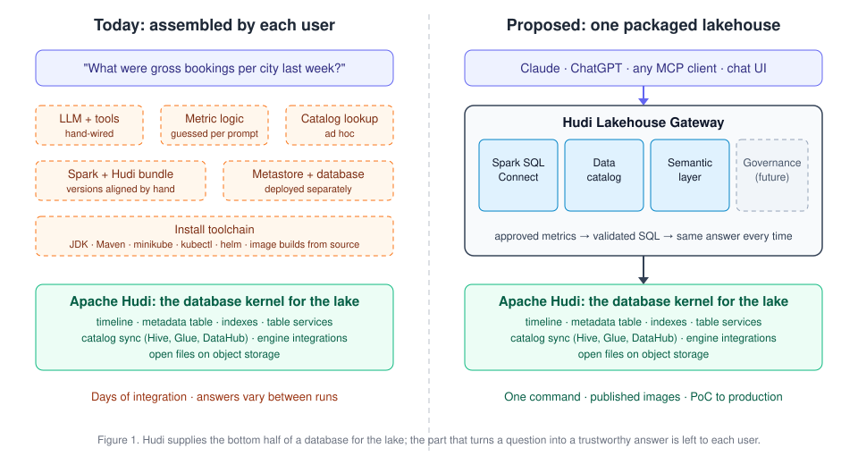

<!--
  Licensed to the Apache Software Foundation (ASF) under one or more
  contributor license agreements.  See the NOTICE file distributed with
  this work for additional information regarding copyright ownership.
  The ASF licenses this file to You under the Apache License, Version 2.0
  (the "License"); you may not use this file except in compliance with
  the License.  You may obtain a copy of the License at

       http://www.apache.org/licenses/LICENSE-2.0

  Unless required by applicable law or agreed to in writing, software
  distributed under the License is distributed on an "AS IS" BASIS,
  WITHOUT WARRANTIES OR CONDITIONS OF ANY KIND, either express or implied.
  See the License for the specific language governing permissions and
  limitations under the License.
-->
# RFC-117: Unified Packaged Lakehouse

## Proposers

- @nsivabalan

## Approvers

- TODO

## Status

Issue: TODO

Claim PR: https://github.com/apache/hudi/pull/20574 · Related discussion: https://github.com/apache/hudi/discussions/19843

> Please keep the status updated in `rfc/README.md`.

## Abstract

Data teams have long asked their lakehouse questions through engines, notebooks and
dashboards. Increasingly the one asking is an LLM agent: a user types a question into
Claude or ChatGPT and expects a correct answer computed from their own tables. Apache
Hudi already supplies the bottom half of a database for the lake: transactional
storage, indexes, table services, catalog sync and engine integrations. The top half
that turns a question into a trustworthy answer is left for every user to assemble.

This RFC proposes the **Unified Packaged Lakehouse**: a Hudi lakehouse delivered as a
single installable unit, fronted by a **gateway** that LLM agents connect to over the
[Model Context Protocol](https://modelcontextprotocol.io/specification/2025-06-18).
For each question the gateway consults a **data catalog** (which tables exist, their
schemas, types and partitions) and a **semantic layer** (the approved business metrics
and how to compute them). It then produces validated SQL, executes it through
**Spark SQL Connect** against Hudi tables, and returns the answer with its provenance.
A **governance layer** follows in a later phase. The whole stack installs with one
command, with Docker as the only prerequisite.

## Motivation

### The database for the lake, without the front door

Hudi was created at Uber in 2016 to bring incremental processing and record-level
mutations to the data lake, and has since grown into what its
[2021 platform vision](https://hudi.apache.org/blog/2021/07/21/streaming-data-lake-platform/)
called "a streaming data lake platform built around a database kernel".
[RFC-69](../rfc-69/rfc-69.md) made the analogy explicit: measured against the classic
[Architecture of a Database System](https://dsf.berkeley.edu/papers/fntdb07-architecture.pdf),
Hudi implements the bottom half of a database (log, storage layout, indexes, concurrency
control, table services), with query engines above it. Hudi 1.0 then argued that
"data lakehouse functionality packaged and delivered like a typical database system
unlocks new use cases"
([announcement](https://hudi.apache.org/blog/2024/12/16/announcing-hudi-1-0-0)). The
[lakehouse paper](https://www.cidrdb.org/cidr2021/papers/cidr2021_paper17.pdf) made the
same bet from the other direction: open, directly accessible files can serve warehouse
workloads without first copying data into a warehouse.

What a user experiences as "a database", though, includes the front door: a way to
connect, ask a question and get back an answer that means what they think it means.
For a Hudi user that front door is still a set of parts to choose, configure and wire
together. That was tolerable when the person asking was a data engineer who already
knew the tables. It is no longer the common case.

### The person asking is changing

In November 2024 Anthropic released the
[Model Context Protocol](https://www.anthropic.com/news/model-context-protocol) (MCP),
an open standard for connecting LLM applications to external tools and data. Adoption
has spread beyond Anthropic: OpenAI's platform connects to
[remote MCP servers](https://developers.openai.com/api/docs/guides/tools-connectors-mcp),
and its developer kit for ChatGPT integrations
[uses MCP](https://developers.openai.com/apps-sdk/quickstart) to expose server-side tools. For a data platform,
"can my agent query it?" is becoming as basic a question as "which engines can read it?".
A lakehouse that cannot be reached by an agent will be bypassed: users will copy data
into whichever system their agent can reach, which is exactly the duplication the
lakehouse exists to remove.

### Pointing an LLM at tables is not enough

The obvious answer is to give the agent a SQL tool and the schema. The evidence says
this does not produce answers a business can rely on:

| Study | Setting | Result |
|---|---|---|
| [BIRD](https://arxiv.org/abs/2305.03111) (NeurIPS 2023) | large, realistic databases | ChatGPT reaches 40.08% execution accuracy; humans reach 92.96% |
| [Spider 2.0](https://arxiv.org/abs/2411.07763) (ICLR 2025) | real enterprise text-to-SQL workflows | the best agent solves 21.3% of tasks, against 91.2% on Spider 1.0 |
| [Sequeda et al.](https://arxiv.org/abs/2311.07509) (2023) | enterprise insurance schema | GPT-4 is accurate on 16% of questions over raw SQL, rising to 54% when business meaning is supplied as a knowledge graph |

Accuracy is low because the meaning is not in the schema. Nothing in the `trips`
table says that *gross bookings* counts only completed trips and includes tips, or
that *average fare per km* is a ratio of sums and not an average of ratios. An LLM fills
these gaps with plausible guesses. Different runs can make different guesses, and a
wrong answer is presented as confidently as a right one. The third study points to the
remedy: accuracy rose sharply once business meaning was supplied explicitly.
Semantic-layer vendors report the same direction on the same benchmark
([dbt Labs](https://www.getdbt.com/blog/semantic-layer-as-the-data-interface-for-llms),
[Cube](https://cube.dev/blog/semantic-layers-the-missing-piece-for-ai-enabled-analytics)),
though on small, self-selected question sets.

This shapes the design. The LLM should choose *which* approved metric answers the
question and with what filters and groupings. It should not invent the formula. The
formula comes from **pre-built semantic models** that the data team owns, compiled into
SQL deterministically, so the same question yields the same SQL and the same number
every time. The **data catalog** covers what the models do not: finding tables, and
giving the agent accurate schemas, types and partitions when it must fall back to
writing SQL itself.

### Why the lakehouse, and why Hudi

Agents ask questions about the business as it is now. That favours answering where the
data already lives, on one copy in open files, rather than exporting it to a separate
serving system first. Hudi is well placed to be that place:

- **Fresh data.** Record-level upserts, merge-on-read tables and incremental pipelines
  keep tables minutes behind their sources, and answers inherit that freshness.
  Reading through the Hudi datasource keeps full snapshot semantics, including
  merging log files and using metadata-table indexes for data skipping.
- **Catalog integration already exists.** Hudi syncs table definitions to the
  [Hive Metastore](https://hudi.apache.org/docs/syncing_metastore), AWS Glue and
  [DataHub](https://hudi.apache.org/docs/syncing_datahub), which the catalog layer can
  build on.
- **A thin path to Spark.** [Spark Connect](https://spark.apache.org/docs/latest/spark-connect-overview.html)
  separates a lightweight client from the Spark server, so a Python gateway can drive
  Spark on Hudi tables without embedding a JVM.
- **The parts exist in this repository.** The agent gateway, the Spark SQL Connect
  endpoint and backend, and the Kubernetes charts have all landed (see
  [Background](#background)).

Commercial data platforms already ship this experience as a built-in feature.
Snowflake's [Cortex Analyst](https://docs.snowflake.com/en/user-guide/snowflake-cortex/cortex-analyst)
answers business questions by generating SQL from semantic views; Databricks'
[Genie](https://docs.databricks.com/aws/en/genie/) answers natural-language questions
governed through Unity Catalog; and BigQuery's
[conversational analytics](https://docs.cloud.google.com/bigquery/docs/conversational-analytics)
lets users chat with data agents about their tables. Each is tied to its vendor's
storage, catalog and compute. Users of an open lakehouse have no equivalent. This RFC
aims to give the Hudi community one: the same question-to-governed-answer experience,
built from open components, running on open data that any engine can still read, and
installable anywhere.

### The assembly problem



To answer even the first example question in this RFC, a user today must:

- run object storage, a metastore and its database;
- run a Spark build whose Spark, Scala, Hadoop and Hudi bundle versions match;
- run a Spark Connect server and the agent gateway;
- configure an LLM provider;
- choose and deploy a semantic layer;
- wire all of it together.

Our own laptop path additionally needs minikube, kubectl, Helm, a JDK and Maven,
because images are built from source. Each step is documented. Together they put the
first answer days away, and most of that time goes to integration rather than to the
user's data. The useful measure is **time to first trustworthy answer**, and this RFC
aims to bring it down to minutes.

### Design principles

1. **Governed answers, not guessed ones.** Metrics come from pre-built semantic models.
   Every response carries its provenance (the metric used and the exact SQL run).
2. **Hudi-native reads.** Queries go through the Hudi datasource with full table
   semantics. Shortcuts that read the files as plain Parquet are not used.
3. **Open and composable.** Apache-licensed components behind small interfaces. The
   catalog and semantic-layer implementations can be swapped without changing the tools
   agents see.
4. **One command, same artifacts.** Published images install on a laptop with Docker
   alone, and the same images and versions run on production Kubernetes.
5. **Safe by default.** The agent path is read-only, validated and row-capped, and
   governance is designed in from the start.

## Requirements

### Top-level requirement

> A user connects an LLM agent (Claude, ChatGPT, or any MCP-capable client) to the
> lakehouse and asks a question in natural language. The system consults the data
> catalog and the semantic layer, generates and validates a SQL query, executes it
> via Spark SQL Connect against Hudi tables, and returns the result to the user.

### Concrete examples

The examples below use a ride-hailing **trips** dataset, in the spirit of the `trips`
table used across Hudi quickstarts:

```
lakehouse.rides.trips         -- Hudi table, partitioned by trip_date
  trip_id       string        -- record key
  rider_id      string
  driver_id     string
  city          string
  trip_status   string        -- completed | cancelled | no_show
  fare_amount   decimal(10,2)
  tip_amount    decimal(10,2)
  distance_km   double
  pickup_ts     timestamp
  dropoff_ts    timestamp
  trip_date     date          -- partition column

lakehouse.rides.drivers       -- dimension table
  driver_id, driver_name, home_city, vehicle_type, onboarded_date
```

| User prompt | What the system must do |
|---|---|
| *"What was our gross booking revenue per city last week?"* | Resolve **gross bookings** to the approved metric (sum of fare + tip on *completed* trips only), group by `city`, apply a last-7-days filter on the `trip_date` partition, execute, return a table. |
| *"Top 10 drivers by completed trips in São Paulo yesterday."* | Use the metric `completed_trips`, join `trips → drivers` on `driver_id` via the approved relationship, filter city + date, rank, limit 10. |
| *"How did average fare per km trend month over month this year?"* | Use metric `avg_fare_per_km` (a ratio metric — must not be computed as an average of per-trip ratios), time grain = month. |
| *"Which tables have rider data, and how are they partitioned?"* | Catalog-only question: list matching tables, show schema, column types, and partition columns. No SQL needed. |

Walkthrough of the first example:

```
User (Claude):  "What was our gross booking revenue per city last week?"

1. Agent → gateway: list_metrics()
   ← gross_bookings, completed_trips, avg_fare_per_km, ...  (from the semantic layer)
2. Agent → gateway: query_metric({
       "metric": "gross_bookings",
       "group_by": ["city"],
       "time_range": "last_7_days"
   })
3. Semantic layer compiles the approved definition into Spark SQL:
     SELECT city, SUM(fare_amount + tip_amount) AS gross_bookings
     FROM lakehouse.rides.trips
     WHERE trip_status = 'completed'
       AND trip_date >= date_sub(current_date(), 7)
     GROUP BY city
4. Gateway validates the SQL (read-only, row cap) and executes it via Spark SQL Connect.
5. Agent ← rows; replies to the user:

   | city          | gross_bookings |
   |---------------|---------------:|
   | san_francisco |   1,284,310.50 |
   | sao_paulo     |     902,447.20 |
   | chennai       |     411,080.75 |      (illustrative numbers)
```

The key property: the definition of "gross bookings" (completed trips only, fare +
tip) comes from the semantic layer, not from the LLM. Asked twice, or by two
different agents, the question yields the same SQL and the same number.

### Goals

1. Any MCP-capable agent (Claude, ChatGPT and others), the built-in chat UI and the
   HTTP API can query a Hudi lakehouse through one gateway.
2. A question covered by a semantic model yields the same SQL and the same result on
   every run. Other questions fall back to guarded, catalog-informed SQL.
3. On a clean machine with only Docker, one command reaches a first answer on the
   sample dataset within minutes.
4. Every installation tier deploys the same published images and versions.

The principles behind these goals are listed under [Design principles](#design-principles).

### Non-goals (for this RFC)

- **Generating semantic models.** The semantic layer consumes models that data teams
  have already authored; authoring or LLM-assisted generation of models is out of scope.
- Writes from the AI agent. The agent path is read-only.
- A native, no-container install tier (see [Installation](#installation)).
- Central policy enforcement (covered by the future governance layer).

## Background

Much of the foundation already exists in the Hudi repository:

| Piece | Location | Reference |
|---|---|---|
| Hudi agent gateway: MCP server, `/v1/chat` agent loop (sessions, streaming), chat UI, guarded SQL tools | `hudi-agent-gateway/` | #19265 |
| Spark SQL Connect endpoint (Helm chart + image) | `hudi-lakehouse/charts/hudi-spark-connect`, `hudi-lakehouse/images/spark-connect` | #20243 |
| Gateway Spark SQL Connect backend (`GATEWAY_SQL_BACKEND=spark-connect`) | `hudi-agent-gateway/` | #20329 |
| Superset and Zeppelin integrations over Spark SQL Connect | `hudi-lakehouse/superset-spark-connect` | #20467 |
| Spark SQL Connect quickstart validation (tests + CI workflow) | `hudi-lakehouse/tests`, `.github/workflows` | #20462 |
| Laptop environment (MinIO, Hive Metastore, Spark operator) on minikube | `hudi-lakehouse/local-dev` | — |

Today's gateway tools are `list_tables`, `describe_table`, and `query_lakehouse` (a
single read-only `SELECT`, validated at the AST level and row-capped). What is missing:

1. **A semantic layer.** The agent writes SQL from schemas alone, so business metrics
   are re-derived on each question and can differ between runs.
2. **A defined catalog interface** in the gateway, so catalog backends can be swapped
   or added without changing the tools agents see.
3. **A simple installation.** The only packaged path today is minikube, which requires
   Docker, minikube, kubectl, and helm — and, because images are built from source,
   Maven and a JDK.

## Architecture

### Building blocks

```
┌──────────────────────────────────────────────────────────────────────────┐
│                        LLM agents and clients                            │
│      Claude · ChatGPT · any MCP client · Chat UI · HTTP API · BI tools   │
└────────────────────────────────────┬─────────────────────────────────────┘
                                     │  MCP · HTTP
┌────────────────────────────────────▼─────────────────────────────────────┐
│                        Hudi Lakehouse Gateway                            │
│                                                                          │
│   Agent interfaces:  MCP server  ·  agent chat API  ·  chat UI           │
│                                                                          │
│  ┌──────────────┐  ┌──────────────┐  ┌──────────────┐  ┌──────────────┐  │
│  │  Spark SQL   │  │ Data catalog │  │   Semantic   │  │  Governance  │  │
│  │   Connect    │  │              │  │    layer     │  │   (future)   │  │
│  │              │  │ tables,      │  │ metrics,     │  │ identity,    │  │
│  │ executes SQL │  │ schemas,     │  │ dimensions,  │  │ access       │  │
│  │ and reads    │  │ types,       │  │ joins →      │  │ policy,      │  │
│  │ on Hudi      │  │ partitions   │  │ SQL          │  │ audit        │  │
│  └──────────────┘  └──────────────┘  └──────────────┘  └──────────────┘  │
└────────────────────────────────────┬─────────────────────────────────────┘
                                     │
┌────────────────────────────────────▼─────────────────────────────────────┐
│                             Storage layer                                │
│   Hudi tables: timeline · metadata table · base and log files            │
│   Object storage: S3 · GCS · ADLS · HDFS · MinIO                         │
└──────────────────────────────────────────────────────────────────────────┘
```

| Block | Role in answering a prompt | Status |
|---|---|---|
| **Storage layer** | Hudi tables on object storage; Hudi's timeline is the source of truth for committed data. | Exists |
| **Agent interfaces** | How agents connect: MCP for external agents (Claude, ChatGPT); `/v1/chat` when the gateway runs its own agent loop; a chat UI for humans. | Exists |
| **Spark SQL Connect** | Executes the final SQL (and DataFrame reads) against Hudi tables. | Exists (#20243, #20329) |
| **Data catalog** | Answers "what tables exist, what are their schemas, types, partitions?" | Exists in basic form (via Spark); options in [Data catalog](#data-catalog) |
| **Semantic layer** | Turns a business question ("gross bookings by city") into correct SQL using approved definitions. | New; options in [Semantic layer](#semantic-layer) |
| **Governance** | Who may see which tables/columns; audit of what was asked and run. | Future; see [Governance](#governance-future) |

### Request flow

```
 Agent                         Gateway                          Backends
   │  list_metrics()              │                                │
   │ ───────────────────────────► │ ── semantic layer ───────────► │ approved models
   │  search_datasets("rider")    │                                │
   │ ───────────────────────────► │ ── data catalog ─────────────► │ tables, schemas, partitions
   │  query_metric(intent)        │                                │
   │ ───────────────────────────► │ ── semantic layer: compile ──► │ Spark SQL
   │                              │ ── validate (read-only, cap)   │
   │                              │ ── Spark SQL Connect ────────► │ Hudi tables
   │ ◄─────────────────────────── │ rows + provenance (metric, SQL)│
```

Two query paths:

- **Metric path (preferred).** The agent sends a structured *intent* — metric,
  dimensions, filters, time range, ordering, limit. The semantic layer produces the
  SQL deterministically from approved definitions.
- **Fallback path.** When no metric covers the question, the agent uses catalog
  metadata to write SQL itself, through the existing guarded `query_lakehouse` tool
  (single read-only statement, row cap, timeout).

Every response carries provenance: which metric was used, and the exact SQL run.

### Gateway tool surface

| Tool | Backed by | Purpose |
|---|---|---|
| `search_datasets(query)` | Data catalog | Find candidate tables by name or description |
| `get_table_schema(table)` | Data catalog | Columns, types, comments |
| `get_partitions(table)` | Data catalog | Partition columns and values |
| `list_metrics()` / `describe_metric(name)` | Semantic layer | Available metrics, dimensions, valid groupings |
| `query_metric(intent)` | Semantic layer → Spark SQL Connect | Governed metric query |
| `query_lakehouse(sql)` | Spark SQL Connect | Guarded fallback SQL (exists today) |

The same tools are exposed over MCP, used by the built-in agent loop, and listed at
`GET /v1/tools`. Existing `list_tables` / `describe_table` map onto the catalog tools.

## Installation

### Goals

- **Sleek:** one command from nothing to a working lakehouse that answers a question.
- **No extra runtime setup:** users who don't have a JDK, Maven, or Kubernetes should
  not need to install them. Every JVM component (Spark, Hive Metastore) ships inside a
  container image; nothing is built from source on the user's machine.
- **Useful on first run:** sample Hudi data and a sample semantic model are loaded, so
  the first prompt works.
- **One set of artifacts:** the same published images and versions are used in every tier.

### Three installation tiers

| Tier | For | Prerequisites | How |
|---|---|---|---|
| **1. Docker Compose** (default) | first-time users, demos, local development | Docker | one command |
| **2. Local Kubernetes** (minikube / kind) | contributors, testing the Helm charts | Docker, minikube or kind, kubectl, helm | `hudi-lakehouse/local-dev/scripts/up.sh` |
| **3. Production Kubernetes** | operators | an existing cluster, helm | `helm install` |

A native (no-container) tier is not proposed: Spark and the Hive Metastore require a
JVM, and shipping a bundled Java runtime per OS/architecture would add large artifacts
without changing what users can do. A JVM-free, read-only exploration mode (for
example on `hudi-rs`) can be considered separately.

### Tier 1: Docker Compose

```bash
curl -fsSL https://hudi.apache.org/lakehouse.sh | sh
```

The script:

1. Checks that Docker is running with enough memory; fails with a clear message otherwise.
2. Downloads the release's versioned `compose.yaml` and `.env` into `./hudi-lakehouse/`.
3. Configures the LLM: an API key (Anthropic, OpenAI) from the environment or a prompt,
   or a local Ollama if one is detected.
4. Runs `docker compose up -d --wait`, pulling published images.
5. Loads the sample `trips` / `drivers` tables and the sample semantic model.
6. Prints next steps:

```
Chat UI:        http://localhost:8000/ui
Connect Claude: claude mcp add --transport http hudi http://localhost:8000/mcp/
Spark Connect:  sc://localhost:15002
```

| Default services | Optional (Compose profiles) |
|---|---|
| `gateway` | `superset`, `zeppelin` (`--profile bi`) |
| `spark-connect` (Spark local mode, laptop-sized) | `ollama` (`--profile local-llm`) |
| `hive-metastore` | semantic-layer service, if the chosen option runs as a service |
| `minio` + bucket setup | `trino` (`--profile trino`) |
| `seed` (one-shot sample data) | |

Ports bind to `127.0.0.1` by default.

### Tier 2: Local Kubernetes

The existing `hudi-lakehouse/local-dev` environment, changed to **pull published
images by default**. Building images from source (Maven + JDK) remains available as an
opt-in for contributors testing local changes.

### Tier 3: Production Kubernetes

An umbrella Helm chart with each component toggled through values, pointing at the
user's own catalog and object storage:

```bash
helm repo add hudi https://hudi.apache.org/charts
helm install lakehouse hudi/hudi-lakehouse -f my-values.yaml
```

### Packaging and release work

1. **Published images** for each component (Spark SQL Connect, gateway, metastore,
   seed) as part of every release. Requires agreement on ASF convenience-binary
   publishing (namespace, cadence).
2. **Versioned install artifacts** per release: `lakehouse.sh`, `compose.yaml`, Helm repo.
3. **One source of truth** for image tags and defaults, generating both the Compose
   file and Helm values, so the tiers cannot drift.
4. **Resource guidance** per tier (to be measured): roughly 4 CPU / 8 GB for the
   default Compose stack; more with BI tools or on minikube.

## Implementation

### Spark SQL Connect

The execution layer is already in place:

- **Endpoint** (#20243): a Helm-deployable Spark Connect server with the Hudi bundle,
  backed by a durable metastore. Clients connect at `sc://<host>:15002`.
- **Gateway backend** (#20329): `GATEWAY_SQL_BACKEND=spark-connect` routes the
  gateway's SQL tools through Spark SQL Connect; guardrails use the Spark SQL dialect.
- **BI integrations** (#20467): Superset and Zeppelin connect to the same endpoint.
- **Quickstart validation** (#20462): an end-to-end check of the Spark SQL Connect quickstart.

What this RFC adds: Compose packaging of the endpoint (Spark local mode for
laptops), published images, and the semantic-layer execution path. Spark SQL Connect
supports SQL reads, DataFrame reads, and SQL writes for direct clients; the agent path
uses reads only. Client libraries (PySpark Connect) do not need a JVM.

### Data catalog

#### Requirements

The gateway needs, for every table it can query:

| Requirement | Example |
|---|---|
| Table discovery | "which tables contain rider data?" → `rides.trips`, `rides.riders` |
| Schemas | columns of `rides.trips` |
| Data types | `fare_amount decimal(10,2)`, `pickup_ts timestamp` |
| Partitions | `trips` partitioned by `trip_date`; available partition values |

#### Two kinds of catalog

| | Technical catalog | Discovery catalog |
|---|---|---|
| Question it answers | "Where is this table and what shape is it?" | "Which table should I use, and what does it mean?" |
| Main consumer | engines (Spark, Trino, Flink) | people and AI agents |
| Content | names, locations, format, schema, types, partitions | descriptions, ownership, glossary, tags, lineage, quality — plus copied technical metadata |
| In the query path? | yes — the engine needs it to run SQL | no — queries run without it |
| Kept current by | engine DDL, Hudi catalog sync | ingestion or push from other systems |

The four requirements above are technical metadata. A technical catalog is mandatory
(Spark cannot resolve tables without one); a discovery catalog improves table
selection for ambiguous questions but is optional.

#### Options

| Option | Kind | Discovery / schemas / types / partitions | Hudi integration | Extra services | Packable in Compose | Pros | Cons |
|---|---|---|---|---|---|---|---|
| **Hive Metastore (HMS)** | technical | yes / yes / yes / yes | native Hive sync; Spark reads through the Hudi datasource | none (already in the stack) | yes | already used by Spark SQL Connect and the charts; universal engine support | dated Thrift API; little business context beyond comments; synced partitions can lag (Hudi's own metadata is used instead) |
| **AWS Glue Data Catalog** | technical (managed) | yes / yes / yes / yes | native Glue sync | none (managed) | no | nothing to operate; IAM / Lake Formation permissions | AWS-only; cannot be packaged |
| **Apache Gravitino** | federated technical | yes / yes / yes / yes (read from HMS) | metadata only: Hudi catalog is read-only and backed by HMS; its Spark and Trino connectors do not read Hudi tables correctly | one JVM service and its database | yes | one REST API over HMS, Glue, Iceberg REST, JDBC sources and filesets; tags, owners, policies and role-based access control | adds a service on top of HMS rather than replacing it; its access control does not apply to reads that go to HMS directly |
| **Unity Catalog OSS** | technical | yes / yes / yes / yes (as Delta or Iceberg) | through Apache XTable (Hudi → Delta or Iceberg); read-only; merge-on-read tables expose the read-optimized view | one service and an XTable sync step | yes | modern REST API; privileges built in | loses merge-on-read freshness and Hudi read optimizations; the table is registered twice; privileges do not cover native Hudi reads through HMS |
| **Apache Polaris** | technical (Iceberg REST) | yes / yes / yes / yes (as Iceberg) | through Apache XTable (Hudi → Iceberg); same limits as Unity Catalog | one service and an XTable sync step | yes | standard Iceberg REST protocol; strong access control | same trade-offs as Unity Catalog |
| **DataHub** | discovery | strong search / copies of technical metadata | native: `hudi-sync/hudi-datahub-sync` | about four (metadata service, Kafka, search index, database) | heavy | best search, glossary, ownership and lineage; strongest Hudi fit among discovery catalogs | heavy footprint; can lag the source; still needs a technical catalog |
| **OpenMetadata** | discovery | strong search / copies of technical metadata | generic Hive / data lake ingestion | about four (server, search index, database, ingestion runner) | heavy | discovery, data quality and profiling in one product | heavy footprint; weaker Hudi fit; still needs a technical catalog |

Discovery catalogs and the semantic layer overlap on "which table should be used".
A discovery catalog *describes* every table in the lake; the semantic layer *defines*
the important metrics on a curated set of tables. Questions on modelled metrics never
need discovery. Ad hoc questions fall back to the technical catalog (names, comments,
schemas), which is enough while the lake has few tables. A discovery catalog becomes
worthwhile when the lake has many tables with similar or confusing names.

#### Proposal

- **v1: Hive Metastore** as the technical catalog (AWS Glue for deployments on AWS).
  It is already in the stack, Hudi syncs to it natively, and Spark SQL Connect reads
  Hudi tables through it with full Hudi semantics.
- **Governance phase: Apache Gravitino is the leading candidate.** It federates
  HMS and other catalogs behind one API and provides tags, policies and role-based
  access control. Before adoption we must confirm how its privileges can be enforced
  on Spark reads of Hudi tables, since those reads resolve tables through HMS, not
  through Gravitino.
- **Optional discovery adapters:** DataHub first (native Hudi sync), then OpenMetadata.
- **Unity Catalog OSS and Apache Polaris:** possible through XTable for copy-on-write
  and read-optimized use. Revisit together with the governance decision.

#### Integration approach

The gateway defines a small **catalog interface** (`search_datasets`,
`get_table_schema`, `get_partitions`, `capabilities`), implemented by adapters:

- A default adapter that reads the engine's technical catalog through Spark SQL
  Connect (`SHOW TABLES`, `DESCRIBE TABLE`, `SHOW PARTITIONS`, table and column
  comments). Hudi answers partition listings from its own metadata, so partitions
  are current even when catalog sync lags.
- Additional adapters (Gravitino, a discovery catalog) behind the same interface,
  without changing the tools agents see. Adapters can be combined, for example
  schemas from one source and descriptions from another.
- Each adapter maps the names its catalog returns to names Spark SQL Connect can
  query, and declares optional capabilities (tags, lineage, glossary) that the agent
  uses when present.

With Gravitino in place, data still does not flow through it: the gateway reads
metadata from Gravitino, while Spark SQL Connect resolves the same tables in the same
HMS and reads them with the Hudi datasource. Gravitino's own Spark connector is not used.

#### What the adapter layer makes easy to change

| Change | Effort |
|---|---|
| Add or swap the gateway's metadata source (HMS, Gravitino, DataHub) | low: one adapter module; agent tools unchanged |
| Combine metadata sources | low: merged inside the adapter layer |
| Change the catalog Spark resolves tables against (for example HMS to Unity Catalog or Polaris) | high: Spark catalog configuration, table registration or migration, Hudi sync target, read-path validation |
| Change table naming (for example two-level to three-level names) | medium: semantic models reference table names and must be updated |
| Move privileges and policies between catalogs (after governance exists) | high: privileges are stored in the catalog |

The v1 choice is therefore cheap to make and cheap to extend. The engine catalog
becomes hard to change once governance stores privileges in it, so the detailed
evaluation belongs to the governance phase. To keep later changes mechanical, models
and tools use fully qualified table names.

### Semantic layer

#### Requirements

- **Consume pre-built models only.** Data teams author and maintain the semantic
  models (metrics, dimensions, entities, join paths) as versioned files. The
  lakehouse loads and serves them. Generating or inferring models is out of scope.
- Compile a structured query intent into SQL that runs on Spark SQL Connect.
- Correctness by construction: approved metric definitions, valid join paths, no
  fan-out double counting, correct ratio metrics.
- Expose metric metadata (names, descriptions, valid dimensions) so the agent can
  choose the right metric.
- Fit the installation goals: small footprint, no extra prerequisites.

Example model (illustrative, MetricFlow-style) for the trips dataset:

```yaml
semantic_models:
  - name: trips
    model: ref('trips')
    entities:
      - { name: trip,   type: primary, expr: trip_id }
      - { name: driver, type: foreign, expr: driver_id }
    dimensions:
      - { name: city,      type: categorical }
      - { name: trip_date, type: time, type_params: { time_granularity: day } }
    measures:
      - { name: bookings,    agg: sum,   expr: "fare_amount + tip_amount" }
      - { name: trip_count,  agg: count, expr: trip_id }
      - { name: distance,    agg: sum,   expr: distance_km }
      - { name: fare,        agg: sum,   expr: fare_amount }

metrics:
  - name: gross_bookings
    type: simple
    type_params: { measure: bookings }
    filter: "{{ Dimension('trip__trip_status') }} = 'completed'"
  - name: completed_trips
    type: simple
    type_params: { measure: trip_count }
    filter: "{{ Dimension('trip__trip_status') }} = 'completed'"
  - name: avg_fare_per_km
    type: ratio
    type_params: { numerator: fare, denominator: distance }
```

#### Options

Candidates were assessed against five criteria:

1. A license compatible with an Apache project.
2. Consumes models the data team authors.
3. Produces SQL that Spark SQL Connect can run, or executes through Spark Connect itself.
4. A runtime light enough for the one-command install.
5. Evidence of adoption and active maintenance.

Maturity signals are GitHub stars and most recent activity as of November 2026.

| Option | License | Runtime | Model format | Path to Spark SQL Connect | Serving APIs | Maturity | Pros | Cons |
|---|---|---|---|---|---|---|---|---|
| **[MetricFlow](https://github.com/dbt-labs/metricflow)** (dbt Labs) | Apache 2.0 (since 0.209.0) | Python library | dbt semantic models and metrics (YAML) | renders SQL with Spark / Databricks dialect adapters; gateway executes | Python API (hosted serving APIs are commercial) | ~1.9k stars; release v0.213.0 (Sep 2026); powers the dbt Semantic Layer | embeds in the gateway, no extra service; metric-centric; strong join and fan-out handling | tied to the dbt project structure (semantic manifest); no open-source serving API |
| **[Cube Core](https://github.com/cube-js/cube)** (Cube Dev) | Apache 2.0 (some packages MIT) | Node.js service (optional Rust cache store) | cubes and views (YAML or JavaScript) | compiles to SQL; gateway executes (no Spark Connect driver) | REST, GraphQL, SQL API over the Postgres wire protocol | ~21k stars; releases weekly | richest serving APIs; caching and pre-aggregations; BI tools share the same definitions | one more service in every install; JavaScript ecosystem |
| **[Wren engine](https://github.com/Canner/WrenAI/tree/main/core)** (Canner) | Apache 2.0 for the engine (`core/`); other paths licensed separately | Rust on Apache DataFusion, with a Python package | MDL (JSON: models, relationships, metrics, views) | native: its Spark connector opens a Spark Connect session (`sc://`) | Python SDK, CLI, MCP server | ~18k stars (WrenAI repository); active; standalone engine repo archived and merged into WrenAI | already speaks Spark Connect; built for LLM agents; Python-friendly | younger model format; repository license notes future modules may be AGPL; product, not foundation, governance |
| **[Boring Semantic Layer](https://github.com/boringdata/boring-semantic-layer)** | MIT | Python, built on Ibis | Python API and YAML | through Ibis's PySpark backend (Spark Connect support to be validated) | Python library, MCP server | ~490 stars; frequent releases; small team | very small footprint; pure Python; MCP built in | young; Spark path untested; small maintainer base |
| **[Malloy](https://github.com/malloydata/malloy)** | MIT | TypeScript / Node.js | Malloy language (`.malloy`) | no Spark SQL dialect (Databricks dialect exists; compatibility with open-source Spark unverified) | Malloy Publisher: REST, MCP | ~2.6k stars; versions still 0.0.x | expressive modelling language; strong design pedigree | a new query language rather than a metric model; no Spark dialect; Node runtime |
| **[Sidemantic](https://github.com/sidequery/sidemantic)** | AGPL-3.0 | Python (sqlglot) | own YAML; imports Cube, MetricFlow, LookML and Malloy models | native Spark SQL dialect | CLI, Python | small; active | broad model import; Spark dialect | AGPL is not compatible with distribution in an Apache project |
| **[Apache Kylin](https://github.com/apache/kylin)** | Apache 2.0 | JVM service with its own Spark and metadata store | OLAP cube models | executes queries itself from precomputed cuboids; does not emit SQL for an external engine | JDBC, ODBC, REST | ~3.8k stars; last release 5.0.2 (Apr 2025) | mature Apache OLAP; sub-second precomputed answers | heavy; duplicates Spark rather than compiling for it |

**Excluded as proprietary or tied to one platform:** LookML (Looker), AtScale,
Snowflake semantic views and Databricks metric views. They are mature, but cannot be
packaged in an open distribution, and the last three serve only their own platforms.

**Model portability: [Apache Ossie](https://github.com/apache/ossie).** Ossie (formerly
the Open Semantic Interchange) is an incubating Apache project backed by Snowflake,
Salesforce, Databricks and dbt Labs. It standardizes how semantic models are
exchanged. It is a specification with converters (dbt, Cube, Snowflake, Databricks and
others), not an engine: one of the options above would still compile and run the
queries. It is promising, because accepting models in Ossie format and converting them
to the chosen engine's format would let users bring models they already have and keep
the engine choice reversible. However, Ossie has no official release yet, so it cannot
be selected as part of this proposal. We will track it and revisit once a release is
published.

**Downstream consumers.** BI tools such as Apache Superset are adding pluggable
semantic-layer support (Cube and MetricFlow first). These consume a semantic layer;
they do not replace one.

#### Shortlist

| Tier | Options | Why |
|---|---|---|
| Leading | MetricFlow, Cube Core | most mature and widely adopted; Apache-licensed; proven model formats |
| Worth prototyping | Wren engine, Boring Semantic Layer | lighter, agent-oriented, Python-friendly; Wren already speaks Spark Connect |
| Not suitable as default | Sidemantic (license), Malloy (no Spark dialect, different model), Apache Kylin (an engine, not a compiler) | see table |

Any option runs in **compile-only** mode: the semantic layer produces SQL; the gateway
validates it and executes it on Spark SQL Connect. Every candidate's SQL must be
validated against Spark SQL before it is accepted.

The main decision driver: whether BI tools must share the same metric definitions in
the first release (favours Cube) or the agent is the primary consumer (favours
MetricFlow, or one of the lighter Python options, embedded in the gateway).

### Governance (future)

Not part of the first implementation, but the architecture reserves a place for it:

| Plane | Covers | Likely implementation |
|---|---|---|
| Metadata governance | owners, tags, PII classification, audit context | Apache Gravitino (leading candidate) or a discovery catalog |
| Data access governance | table / column privileges, row filters, masking | engine-native policies first; Gravitino access control (if it can be enforced on Spark reads), Apache Ranger or OPA later |
| Gateway governance | authenticating callers, forwarding identity to the engine, permission-aware catalog results, query audit log | gateway |

Initial baseline: the agent path is read-only; Compose binds to localhost; production
deployments sit behind an authenticating proxy. Gateway authentication is required
before remote MCP clients (such as ChatGPT, which connects over the internet) can be
supported in production.

## Extension: Spark Job Submission (stretch)

Beyond interactive queries, users will want to run batch work against the same
lakehouse: ingestion jobs, backfills, and table services (compaction, clustering,
cleaning).

| Tier | Mechanism |
|---|---|
| Docker Compose | a runner container submitting to Spark in local mode or a small fixed-size cluster |
| Local / production Kubernetes | `SparkApplication` via the Spark Kubernetes operator (already used by `local-dev`), with executor pods |

Exposed through a gateway API and CLI first. Exposing job submission as an agent tool
needs explicit approval controls and is deferred until the governance layer exists.

## Rollout / Adoption Plan

| Phase | Scope |
|---|---|
| 1. Packaging | published images; `lakehouse.sh` + `compose.yaml`; sample data; local-dev pulls images by default |
| 2. Catalog interface | new catalog tools and default adapter; existing tools kept as aliases |
| 3. Semantic layer | chosen option integrated (compile-only); metric tools; sample model |
| 4. Production | umbrella Helm chart and Helm repository; gateway authentication |
| Later | Gravitino and discovery catalog adapters; governance; Spark job submission |

Existing users are unaffected: current charts keep working, and the gateway keeps its
existing tools and configuration.

## Test Plan

- **Install test (per release candidate):** run `lakehouse.sh` on a clean machine; assert
  all services are healthy, sample tables are readable, and a canned prompt returns
  the expected answer (with a scripted model for determinism).
- **Tier parity:** generate Compose and Helm values from the shared version source;
  assert identical image tags.
- **Prompt-to-answer evaluation:** 30–50 questions over the sample dataset (metrics,
  joins, filters, time ranges, ratio metrics, ambiguous wording); track pass rate per release.
- **Semantic compilation:** golden SQL for each sample metric; executed results checked
  against hand-written queries.
- **Guardrails:** existing validation suite extended for semantic-compiled SQL.
- **Catalog freshness:** after a Hudi commit adding a column or partition, the change
  is visible through the catalog tools.
- **Charts:** existing `hudi-lakehouse/tests` on minikube or kind.

## Open Questions

1. Data catalog: how can Gravitino's privileges be enforced on Spark reads of Hudi tables that resolve through HMS? (Decides whether Gravitino anchors the governance layer.)
2. Semantic layer: which shortlisted option is the default (MetricFlow, Cube Core, or a lighter option after prototyping), and must BI tools share metric definitions in the first release?
3. ASF policy for publishing images and a Helm repository; namespace and cadence.
4. Metastore backend in Compose: embedded (simplest) or a separate database (durable across upgrades)?
5. Default LLM for first run: bring-your-own API key, host Ollama, or a bundled local model profile?
6. Gateway authentication design for remote MCP clients.
7. Should the gateway's default SQL backend change from Trino to Spark SQL Connect?
8. Semantic models: should the lakehouse accept Apache Ossie models once Ossie publishes a release?
